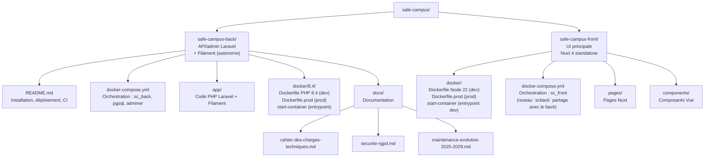

# Safe Campus — back (SAE501)

Installation de l'environnement de développement (§ 0 à 4), déploiement en production (§ 5) et intégration continue (§ 6). Le code s'édite sur l'hôte (WSL), toutes les commandes PHP/Composer/Artisan s'exécutent dans le container.

Dépôts GitHub : [Korrighed/safe-campus-back](https://github.com/Korrighed/safe-campus-back) (ce dépôt) et [Korrighed/safe-campus-front](https://github.com/Korrighed/safe-campus-front) (site étudiant).

Documentation du projet dans `docs/` : [cahier des charges techniques](docs/cahier-des-charges-techniques.md), [sécurité et RGPD](docs/securite-rgpd.md), [maintenance évolutive](docs/maintenance-evolutive-2025-2029.md).

---

## 0. Installation de WSL (Windows uniquement)

### Activer WSL

Dans un terminal PowerShell **en administrateur** :

```powershell
wsl --install
```

Redémarre la machine si demandé, puis installe une distro Ubuntu :

```powershell
wsl --install -d Ubuntu-24.04
```

Au premier lancement, WSL demande de créer un utilisateur Linux (nom + mot de passe).

Vérifier que la distro est bien active :

```powershell
wsl --list --running
```

### Configurer Git dans WSL

```bash
git config --global user.name "Prénom Nom"
git config --global user.email "ton@email.com"
```

Git s'utilise depuis WSL, à l'extérieur des containers.

### Configurer SSH pour GitHub

Générer une clé SSH (laisser la passphrase vide en appuyant sur Entrée) :

```bash
ssh-keygen -t ed25519 -C "ton@email.com"
```

Afficher la clé publique :

```bash
cat ~/.ssh/id_ed25519.pub
```

Copier la clé affichée, puis sur GitHub : **Settings → SSH and GPG keys → New SSH key** → coller et sauvegarder.

Tester la connexion :

```bash
ssh -T git@github.com
```

> La réponse attendue est `Hi <username>! You've successfully authenticated`.

### Cloner les deux dépôts

Chaque repo a son propre `docker-compose.yml` et se lance indépendamment. Les cloner dans un dossier parent commun reste conseillé pour s'y retrouver, mais ce n'est plus une contrainte technique.

```bash
mkdir -p ~/workspace/safe-campus && cd ~/workspace/safe-campus
git clone git@github.com:Korrighed/safe-campus-back.git
git clone git@github.com:Korrighed/safe-campus-front.git
```

---

## 1. Logiciels requis

| Outil          | Version minimale | Lien                                           |
| -------------- | ---------------- | ---------------------------------------------- |
| Docker Desktop | 4.x              | https://www.docker.com/products/docker-desktop |
| VS Code        | 1.85+            | https://code.visualstudio.com                  |
| Git            | 2.x              | https://git-scm.com                            |

---

## 2. Configuration Docker Desktop (WSL)

Sous Windows avec WSL 2, Docker Desktop ne communique pas automatiquement avec toutes les distros WSL.

Activer l'intégration : **Docker Desktop** → **Settings** → **Resources** → **WSL Integration** (sous-onglet dans Resources) → cocher la distro cible (ex. `Ubuntu-24.04`).

Sans cette étape, toute commande `docker` depuis WSL retourne `Cannot connect to the Docker daemon`.

---

## 3. Extensions VS Code

Le projet s'ouvre dans WSL. Extensions nécessaires côté hôte Windows :

```bash
code --install-extension ms-vscode-remote.remote-wsl
code --install-extension ms-azuretools.vscode-docker
```

> Remote WSL sert de pont entre VS Code (Windows) et le noyau Linux WSL où vit le code.
> Ouvrir le dossier via `code .` depuis un terminal WSL, ou `Ctrl+Shift+P` → **WSL: Open Folder in WSL**.

Extensions PHP/Laravel, installées côté WSL :

```bash
code --install-extension bmewburn.vscode-intelephense-client
code --install-extension xdebug.php-debug
code --install-extension onecentlin.laravel5-snippets
code --install-extension amiralizadeh9480.laravel-extra-intellisense
code --install-extension alperenersoy.filament-snippets
code --install-extension cweijan.vscode-postgresql-client2
code --install-extension mikestead.dotenv
```

> Intelephense analyse le code depuis l'hôte : il lit `vendor/`, écrit dans le bind mount par `composer install`.

---

## 4. Démarrer l'environnement de développement

```bash
cd safe-campus-back
cp .env.example .env
sed -i "s/^WWWUSER=.*/WWWUSER=$(id -u)/" .env
sed -i "s/^WWWGROUP=.*/WWWGROUP=$(id -g)/" .env

docker compose up -d

docker compose exec sc_back php artisan key:generate
docker compose exec sc_back php artisan migrate
docker compose exec sc_back php artisan db:seed
docker compose exec sc_back php artisan storage:link
```
Pour un reset clean: 

```sh 
docker compose exec sc_back php artisan migrate:fresh --seed
```

Le `.env` est lu par Docker avant le build : `WWWUSER`/`WWWGROUP` créent l'utilisateur `scback` aligné sur l'utilisateur hôte, `DB_*` alimente PostgreSQL.

`SC_Back` exécute `composer install` à chaque démarrage, puis `artisan serve`. `key:generate`, `migrate` et `db:seed` sont à la main : l'état de la base est piloté par le dev.

> `migrate` seed automatiquement la taxonomie (themes/sous-themes) et le compte webmaster de démo — donnée structurelle requise par l'app. `db:seed` reste nécessaire à part pour l'annuaire de contacts, les médias et les histoires de démonstration (`ContactSeeder`, `MediaSeeder`, puis `HistoireSeeder` (alcool), `HistoireAnxieteSeeder` (anxiété), `HistoireHarcelementSeeder` (harcèlement), `HistoireTabacSeeder` (tabac), `HistoireDrogueSeeder` (drogue), `HistoireDepressionSeeder` (dépression), `HistoireBurnOutSeeder` (burn-out), `HistoireViolencesSexistesSeeder` (violences sexistes) et `HistoireViolencesSexuellesSeeder` (violences sexuelles), bâtis sur un socle commun `HistoireDemoSeeder` — ignorés en production, sauf `DEMO_CONTENT=true` : voir [Démarrage du conteneur](#démarrage-du-conteneur)). Ces seeders sont idempotents (rejouables sans dupliquer) : `migrate:fresh --seed` remet la base dans son état de référence.
>
> Les tests (`php artisan test`) tournent sur cette même base, sans jamais la vider : chaque test est enveloppé dans une transaction annulée à la fin (`DatabaseTransactions`, voir `tests/TestCase.php`). La base doit donc être migrée et seedée avant de les lancer, et un test crée ses données par factory sans supposer une base vide.

> `storage:link` crée `public/storage` → `storage/app/public` (symlink, gitignoré). Sans ça, les fichiers uploadés via Filament (médias : images, PDF, ...) sont bien enregistrés mais renvoient 404 côté front.

| Conteneur     | Rôle              | Stack                                     |
| ------------- | ----------------- | ----------------------------------------- |
| `SC_Back`     | Laravel (PHP 8.4) | ce repo                                   |
| `SC_Postgres` | PostgreSQL 17     | ce repo                                   |
| `SC_Adminer`  | Interface DB      | ce repo                                   |
| `SC_Front`    | Nuxt 4 + Vite HMR | [safe-campus-front](https://github.com/Korrighed/safe-campus-front) |

Ouvrir le code : `code .` depuis WSL, à la racine du repo.

### Exécuter les commandes dans le container

Le shell hôte n'a ni PHP ni Composer. Toutes les commandes passent par `docker compose exec` :

```bash
docker compose exec sc_back php artisan migrate
```

Ou un shell interactif dans le container :

```bash
docker compose exec sc_back bash
```

Alias pratique à ajouter dans `~/.bashrc` sur WSL :

```bash
alias sc='docker compose exec sc_back'
# usage : sc php artisan migrate
```

> ⚠️ Ne pas relancer `php artisan serve` ni `composer dev` via `exec` : le container sert **déjà** sur le port 8000, le bind échouera.

### Logs

```bash
docker compose logs -f sc_back                                  # sortie du container
docker compose exec sc_back tail -f storage/logs/laravel.log    # log applicatif Laravel
```

### Rebuild de l'image

`docker/8.4/Dockerfile`, `php.ini` et `start-container` sont intégrés à l'image au build. Les modifier impose un rebuild :

```bash
docker compose build sc_back
docker compose up -d
```

Le reste du code vit dans le bind mount et ne nécessite aucun rebuild.

> Ce `docker-compose.yml` est un stack de **développement** uniquement. La stack de production (`docker-compose.prod.yml`, `docker/8.4/Dockerfile.prod`) est décrite au [§ 5](#5-déploiement-en-production).

### Le front

`sc_front` a son propre `docker-compose.yml` dans [safe-campus-front](https://github.com/Korrighed/safe-campus-front) — stack indépendante, à démarrer séparément (`cd ../safe-campus-front && docker compose up -d`). Les deux stacks partagent le réseau Docker `scback` (nom fixe) : si les deux tournent, `sc_front` joint `sc_back` par son nom de conteneur pour le SSR ; sinon `sc_back` reste simplement injoignable depuis le front. Le code du front s'édite dans ce repo, ses commandes passent par `docker compose exec sc_front` (depuis `safe-campus-front`).

### Fichiers médias (images, PDF, ...)

Uploadés depuis le panel Filament (ressource **Médias**), stockés sur le disque `public` (`config/filesystems.php`), sous `storage/app/public/medias/{type}/` — un sous-dossier par valeur de `App\Enums\MediaType`, pour mimer la colonne `type` de la table `medias` :

```
storage/app/public/medias/
├── image/
├── video/
├── audio/
└── document/     ← PDF (fiches ressources)
```

Aucun nouveau volume Docker : `sc_back` bind-mount déjà tout le repo (`.:/var/www/html`), `storage/` persiste comme le reste du code. La stack de prod n'a pas de bind mount : `storage/app` et `storage/logs` sont montés sur les volumes nommés `scback-storage-prod` et `scback-logs-prod` (voir [§ 5](#volumes-et-journaux)).

Servis en statique via le lien symbolique `public/storage` (voir `storage:link` ci-dessus), donc accessibles en lecture directe par le front — un PDF s'ouvre dans un nouvel onglet via un simple lien (`target="_blank"`, pas de viewer embarqué), sans endpoint de téléchargement dédié.

L'API expose l'URL calculée, jamais le chemin disque brut : `Media::url` (accesseur du modèle) → `MediaResource.url` (JSON).

### Débogage Xdebug

Xdebug est actif dans l'image (`docker/8.4/php.ini`, port 9003, `start_with_request = yes`). `/.vscode` étant gitignoré, créer la configuration localement dans `.vscode/launch.json` :

```json
{
  "version": "0.2.0",
  "configurations": [
    {
      "name": "Listen for Xdebug",
      "type": "php",
      "request": "launch",
      "port": 9003,
      "pathMappings": {
        "/var/www/html": "${workspaceFolder}"
      }
    }
  ]
}
```

### Ports exposés

| Port   | Service                   | URL                   |
| ------ | ------------------------- | --------------------- |
| `8000` | Laravel                   | http://localhost:8000 |
| `5432` | PostgreSQL                | —                     |
| `8080` | Adminer                   | http://localhost:8080 |
| `9003` | Xdebug (container → hôte) | —                     |

Ports du front (`sc_front`, stack séparée) : voir le [README de safe-campus-front](https://github.com/Korrighed/safe-campus-front#readme).

Les ports sont publiés par Docker : sous WSL 2 ils sont joignables depuis Windows.

### Connexion Adminer

> Adminer sélectionne `MySQL` par défaut — bien changer le **moteur** en `PostgreSQL` avant de se connecter.

- **Moteur** : `PostgreSQL` *(menu déroulant en haut)*
- **Serveur** : `pgsql`
- **Utilisateur** : valeur de `DB_USERNAME` dans `.env`
- **Mot de passe** : valeur de `DB_PASSWORD` dans `.env`
- **Base de données** : valeur de `DB_DATABASE` dans `.env`

### Connexion au panel admin (Filament)

Panel disponible sur **http://localhost:8000/admin**.

Un compte `webmaster` de démonstration est provisionné automatiquement au `migrate` (hors
production), identifiants bidon définis dans `.env.example` (`WEBMASTER_DEMO_EMAIL` /
`WEBMASTER_DEMO_PASSWORD`) :

| Champ        | Valeur par défaut          |
| ------------ | -------------------------- |
| Email        | `webmaster@safe-campus.nc` |
| Mot de passe | `password`                 |

Pour changer ces valeurs, surcharger `WEBMASTER_DEMO_EMAIL`/`WEBMASTER_DEMO_PASSWORD` dans `.env`
avant `migrate` — le compte n'est (re)créé que s'il n'existe pas déjà.

Un compte `redacteur` de démonstration (`REDACTEUR_DEMO_EMAIL` / `REDACTEUR_DEMO_PASSWORD`, `redacteur@test.local` / `password` par défaut) est créé par `RedacteurDemoSeeder` au `db:seed`. Il est l'auteur des histoires de démonstration.

Un compte `admin` est provisionné de la même façon au `migrate` (`ADMIN_EMAIL` / `ADMIN_PASSWORD`,
valeurs de dev dans `.env.example` : `admin@safe-campus.nc` / `password`). Il gère uniquement les
comptes : validation des inscriptions, attribution des rôles et suppression de comptes (dont sur
demande d'une personne). Un compte sans connexion depuis 3 ans est supprimé automatiquement par
`php artisan comptes:purger-inactifs` (`--simulation` pour lister sans supprimer), planifiée chaque jour.

Toutes les actions du back-office sont tracées dans `storage/logs/audit-AAAA-MM-JJ.log` — voir
[§ 5 Volumes et journaux](#volumes-et-journaux).

Un nouveau compte peut être demandé depuis la page de connexion (« Pas de compte ? Inscrivez-vous »).
Il est créé sans rôle et reste inactif jusqu'à attribution d'un rôle — voir
[cahier des charges § 4.3](docs/cahier-des-charges-techniques.md#43-cycle-de-vie-dun-compte-et-de-son-rôle).

---

## 5. Déploiement en production

Aucun hébergeur n'est imposé : le livrable est un jeu d'images Docker, déployables sur tout hôte Docker. Le reverse proxy, le certificat TLS, la sauvegarde, la supervision et le planificateur sont fournis par l'hébergement choisi. Documentation associée : [cahier des charges](docs/cahier-des-charges-techniques.md), [sécurité et RGPD](docs/securite-rgpd.md), [maintenance et évolution](docs/maintenance-evolutive-2025-2029.md).

### Stack de production

`docker-compose.prod.yml` + `docker/8.4/Dockerfile.prod`. Différences avec le stack de développement :

- Code copié dans l'image au build, pas de bind mount. `composer install --no-dev --optimize-autoloader --no-scripts` au build.
- Pas d'Adminer, pas de port PostgreSQL publié : seul `sc_back` atteint `pgsql`.
- `container_name` et réseau (`scback_prod`) distincts : les stacks de dev et de prod peuvent tourner en parallèle.
- Le conteneur ne parle que HTTP, sur `PORT`, sinon `APP_PORT`, sinon 8000. Le TLS est terminé par le reverse proxy de l'hébergement.
- Le conteneur tourne avec l'utilisateur non administrateur `scback`.

> ⚠️ Points à traiter avant la mise en production :
> - Les images exigent encore le compte visiteur du prototype : sans `VISITEUR_PASSWORD`, la migration `seed_visiteur` échoue. Le portillon (compte, page de connexion, middleware du front) est à retirer au lancement officiel.
> - L'image sert l'application avec `php artisan serve`, serveur de développement mono-processus. À remplacer par PHP-FPM + nginx ou FrankenPHP.
> - Aucun planificateur ne tourne dans l'image : voir [Tâches planifiées](#tâches-planifiées).

### Variables d'environnement

À saisir dans la configuration de l'hébergement : aucun fichier `.env` n'est copié dans l'image. Liste exacte : [.env.production.example](.env.production.example).

| Variable | Valeur de production |
|---|---|
| `APP_ENV`, `APP_DEBUG`, `LOG_LEVEL`, `DB_CONNECTION` | Fixées dans `docker-compose.prod.yml` (`production`, `false`, `error`, `pgsql`) |
| `APP_KEY` | Générée **une seule fois** (`php artisan key:generate --show`), jamais régénérée : la changer invalide sessions, cookies et données chiffrées |
| `APP_URL` | URL publique en HTTPS. Sans elle, les URL des médias pointent sur `http://localhost` |
| `DB_DATABASE`, `DB_USERNAME`, `DB_PASSWORD` | Base dédiée, mot de passe fort (20 caractères aléatoires au moins). L'utilisateur créé par l'image PostgreSQL est superutilisateur : prévoir un utilisateur dédié |
| `SANCTUM_STATEFUL_DOMAINS` | Domaine public du front, sans schéma |
| `CORS_ALLOWED_ORIGINS` | Origines complètes du front (schéma + hôte), séparées par des virgules |
| `TRUSTED_PROXIES` | `*` si le conteneur n'est joignable que par le reverse proxy, sinon IP/CIDR du proxy. Vide derrière un proxy TLS : assets de `/admin` en `http://`, IP du proxy dans le journal d'audit, limite de débit de `/api/login` commune à tous les visiteurs |
| `SESSION_SECURE_COOKIE` | `true` par défaut. `false` seulement pour tester l'image en HTTP sur localhost |
| `ADMIN_EMAIL` / `ADMIN_PASSWORD` | Premier compte admin, créé au premier `migrate`. Mot de passe conforme à la politique (14 caractères, majuscule, minuscule, caractère spécial), sinon la migration échoue. Retirable une fois le compte créé |
| `VISITEUR_EMAIL` / `VISITEUR_PASSWORD` | Portillon visiteur du prototype. Sans objet après le lancement officiel |
| `RUN_MIGRATIONS`, `DEMO_CONTENT` | Optionnelles, `false` par défaut : voir ci-dessous |

Côté front ([README de safe-campus-front](https://github.com/Korrighed/safe-campus-front#readme)) : `NUXT_PUBLIC_API_BASE` (adresse de l'API pour le navigateur) et `NUXT_API_BASE_INTERNAL` (adresse pour le rendu côté serveur) pointent sur l'URL du back. Sans la seconde, les pages de contenu renvoient 404.

### Démarrage du conteneur

Le point d'entrée `docker/8.4/start-prod` :

1. recrée `public/storage` (exclu de l'image) ;
2. si `RUN_MIGRATIONS=true`, lance `migrate --force` ;
3. si `DEMO_CONTENT=true`, rejoue les seeders de démonstration (médias, rédacteur de démo, histoires), idempotents ;
4. sert l'application.

Une tâche qui échoue est signalée dans les journaux (`AVERTISSEMENT`) sans empêcher le démarrage : lire les journaux après chaque déploiement. `DEMO_CONTENT` est réservé à une démonstration, jamais à la production.

### Commandes post-déploiement

À lancer dans `sc_back` après chaque déploiement, par un hook de l'hébergement ou à la main. Elles ne tournent pas au build : `.env` et `APP_KEY` n'y existent pas.

```bash
php artisan package:discover --ansi
php artisan filament:upgrade
php artisan migrate --force
php artisan storage:link
```

> Sauvegarder la base avant tout `migrate --force`. Ne jamais lancer `db:seed` en production. `key:generate` ne s'exécute qu'une fois, avant le premier déploiement.

### Tâches planifiées

`comptes:purger-inactifs` (quotidienne) supprime les comptes sans connexion depuis 3 ans. Aucun planificateur ne tourne dans le conteneur : l'hôte doit lancer `schedule:run` chaque minute.

```bash
* * * * * docker exec SC_Back_Prod php artisan schedule:run >> /dev/null 2>&1
```

Contrôle à blanc : `docker exec SC_Back_Prod php artisan comptes:purger-inactifs --simulation`. `scenes:purger-orphelines [--simulation]` (scènes sans histoire depuis plus de 24 heures) se lance à la main uniquement.

### Volumes et journaux

`storage/app` (médias) et `storage/logs` sont montés sur les volumes nommés `scback-storage-prod` et `scback-logs-prod`, la base sur `scback-pgsql-prod` : un redéploiement ne les efface pas. Leur sauvegarde hors serveur relève de l'hébergement ([plan de maintenance § 7](docs/maintenance-evolutive-2025-2029.md#7-sauvegarde-et-restauration)).

Journal d'audit : canal `audit`, distinct de `laravel.log`. Un fichier JSON par jour (`storage/logs/audit-AAAA-MM-JJ.log`), conservé 365 jours, niveau `info` quel que soit `LOG_LEVEL`. Il trace les créations, modifications et suppressions, les connexions et inscriptions, le circuit des histoires et les purges ; jamais de mot de passe, de jeton ni de texte de scène. Consultation sur le serveur uniquement :

```bash
docker exec SC_Back_Prod tail -f storage/logs/audit-AAAA-MM-JJ.log
```

### Vérifications après déploiement

```bash
curl -s -o /dev/null -w "%{http_code}\n" https://<back>/up
curl -s https://<back>/api/themes | head -c 200
curl -sI -H "Origin: https://<front>" https://<back>/api/themes | grep -i access-control-allow-origin
```

- L'URL d'un média (champ `documents[].url` de `/api/sous-themes/alcool`) répond 200.
- `/admin` : connexion avec le compte admin, cookies `secure` et `httponly`.

| Symptôme | Cause |
|---|---|
| Pages de contenu du front en 404 | `NUXT_API_BASE_INTERNAL` absente côté front |
| Médias en 404 | `storage:link` non lancé |
| Assets de `/admin` en `http://` | `TRUSTED_PROXIES` absente |
| CORS refusé | `CORS_ALLOWED_ORIGINS` différente de l'URL exacte du front |
| Conteneur qui redémarre en boucle | Fichiers `bootstrap/cache/*.php` d'une machine de dev copiés dans l'image (exclus par `.dockerignore`) |

---

## 6. Intégration continue

Workflow `.github/workflows/ci.yml` (**CI**), présent dans les deux dépôts. Aucun déploiement automatique : la CI vérifie seulement. Aucun secret GitHub : les valeurs utilisées sont générées à l'exécution.

| Événement | Jobs |
|---|---|
| Push ou pull request vers `dev` ou `main` | `verif` |
| Pull request vers `main`, push sur `main` | `verif` et `approfondi` |
| Lancement manuel (onglet Actions) | `verif`, plus `approfondi` sur `main` |

| | `verif` | `approfondi` |
|---|---|---|
| **Back** | Pint, migrations et seeders sur PostgreSQL 17, PHPStan niveau 5 sans baseline, tests | `composer audit --locked`, build et démarrage de `docker-compose.prod.yml`, commandes post-déploiement, contrôle HTTP de `/up`, `/api/themes` et des médias, scan Trivy |
| **Front** | `npm ci`, build, typecheck, lint | `npm audit` (bloquant en *critical*), build de l'image de prod, scan Trivy |

Avant de pousser `dev`, le même contrôle que `verif` doit passer en local :

```bash
docker compose exec sc_back vendor/bin/pint --test
docker compose exec sc_back vendor/bin/phpstan analyse
docker compose exec sc_back php artisan test
```

Ruleset de `main` : pull request obligatoire (fusion *Merge*), checks `verif` et `approfondi` verts et à jour, ni suppression ni force-push, historique non linéaire (git flow en `--no-ff`). Après une fusion sur `main`, `dev` doit l'intégrer avant la PR suivante : `git checkout dev && git merge origin/main`. Les noms de checks doivent être identiques à ceux des jobs.

Réglages GitHub de chaque dépôt : actions autorisées (GitHub, `shivammathur/setup-php`, `aquasecurity/*`), approbation des workflows pour tous les contributeurs externes, jeton `GITHUB_TOKEN` en lecture seule, secret scanning et push protection activés. L'action Trivy est épinglée par commit ; les autres par étiquette. Dependabot n'est pas configuré.

---

## 7. Structure du projet


