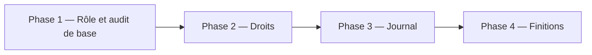
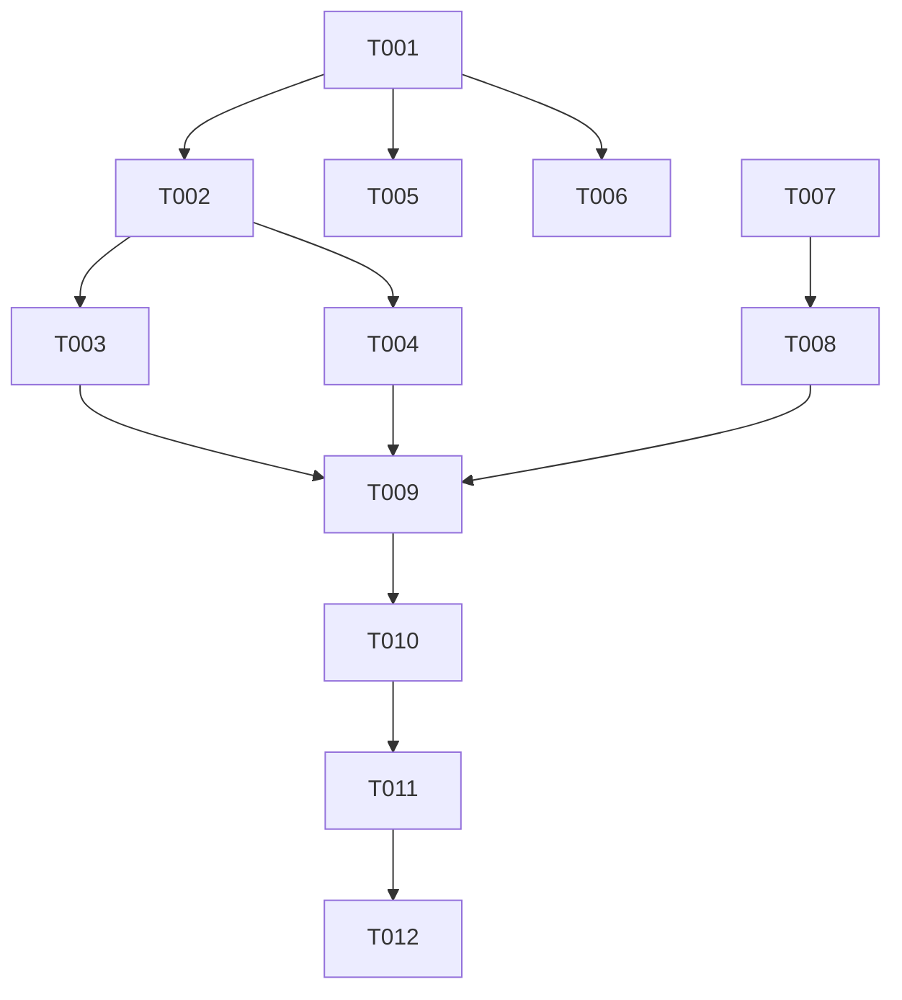

# Plan d'implémentation — Rôle relecteur

Statut : brouillon
Couvre : [PRD](PRD.md) F-01 … F-11, NF-01 … NF-04 · [TRD](TRD.md) T-01 … T-13
Branche : `feature/role-relecteur` (depuis `dev`)

## 1. Objectif du lot

Un relecteur relit, corrige, valide, publie ou renvoie en brouillon toutes les histoires. Un rédacteur ne voit que les siennes et ne peut qu'en demander la relecture. Le journal d'audit trace ces actions sans jamais écrire un texte rédigé.

## 2. Décisions préalables

| # | Question | Décision | Raison |
|---|---|---|---|
| 1 | Rédacteur et histoire hors `brouillon` ? | Verrouillée, lecture seule. | Évite les conflits de correction. |
| 2 | Le relecteur crée-t-il ? | Non, pour le moment. | Demande du porteur. |
| 3 | Scènes entre auteurs ? | Réutilisation limitée à ses histoires. Suppression d'une scène partagée refusée. | Pas de destruction croisée. |
| 4 | Garde-t-on `valide` ? | Oui (option A). | Aucun coût. |
| 5 | Repreneur de comptes supprimés ? | Rédacteur ou relecteur. | Demande du porteur. |
| 6 | Texte en log ? | Jamais, pour scènes et choix. Noms de champs conservés. | Demande du porteur. |
| 7 | Refus d'accès journalisés ? | Oui. | Demande du porteur. |

## 3. Phases

- Phase 1 : T001 (rôle) et T007 (masquage du contenu en log).
- Phase 2 : T002 à T006 (droits, états, scènes, repreneur, guides).
- Phase 3 : T008 à T010 (événements d'audit).
- Phase 4 : T011 (limites de saisie, bloquée), T012 (documentation).

## 4. Tâches

| ID | Tâche | Story | Fichiers cibles | Dépend de | [P] | Statut |
|---|---|---|---|---|---|---|
| T001 | Ajouter le rôle relecteur | US-01 | `UserRole`, migration, `User`, `UserResource`, tests | — | | à faire |
| T007 | Masquer le contenu rédigé dans l'audit | US-06 | `AuditService`, `AuditObserver`, `AuditLogTest` | — | oui | à faire |
| T002 | Cloisonner les histoires par auteur et par état | US-02 | `Histoire`, policies, `HistoireResource`, `HistoireFactory`, tests | T001 | | à faire |
| T005 | Autoriser le relecteur comme repreneur | US-01 | `SuppressionCompteService`, `UserResource`, `UserResourceTest` | T001 | oui | à faire |
| T006 | Guides du tableau de bord | US-03, US-04 | widgets, vues, test | T001 | oui | à faire |
| T003 | États accessibles selon le rôle | US-03, US-04, US-05 | `HistoireResource`, `EditHistoire`, tests | T002 | | à faire |
| T004 | Scènes : lecture seule et partage limité | US-02 | `ScenesHistoire`, vue Blade, tests | T002 | oui | à faire |
| T008 | Événement de changement d'état | US-06 | `HistoireObserver`, `AppServiceProvider`, tests | T007 | | à faire |
| T009 | Événements de rattachement | US-06 | `ScenesHistoire`, `EditHistoire`, tests | T003, T004, T008 | | à faire |
| T010 | Journaliser les accès refusés | US-06 | `HistoireResource`, pages, tests | T009 | | à faire |
| T011 | Limites de saisie visibles | US-03 | formulaires histoire et scène | T010 | | bloquée (question PRD § 10) |
| T012 | Mettre la documentation à jour | tous | `docs/*.md` | T001 à T011 | | à faire |

Fichier détaillé de chaque tâche : `docs/tasks/Txxx-slug.md`.

L'ordre d'exécution conseillé : T001, T007, T002, T005, T006, T003, T004, T008, T009, T010, T011, T012. Le `[P]` signale l'absence de fichier commun avec les tâches de la même vague. L'exécution reste séquentielle (une tâche, un commit, un arrêt).

## 5. Graphe de dépendances

## 6. Vérification du lot

| Contrôle | Commande / méthode | Attendu |
|---|---|---|
| Format | `docker compose exec sc_back vendor/bin/pint --test` | 0 erreur |
| Analyse statique | `docker compose exec sc_back vendor/bin/phpstan analyse` | 0 erreur |
| Tests | `docker compose exec sc_back php artisan test` | tous verts |
| Migration | `php artisan migrate:rollback --step=1` puis `php artisan migrate` | réversible |
| Parcours | passe `qa`, comptes rédacteur A, rédacteur B, relecteur | conforme au [PRD](PRD.md) § 6 |

## 7. Risques

| Risque | Probabilité | Impact | Parade |
|---|---|---|---|
| Les tests tournent sur la base de dev : la migration doit y être appliquée avant les tests. | Certaine | Moyen | T001 impose `php artisan migrate` avant tout test. |
| Tests existants qui supposent qu'un rédacteur voit toutes les histoires. | Certaine | Moyen | T002 les corrige (factory `pour($auteur)`). |
| Ordre des hooks Filament pour la sauvegarde des sous-thèmes. | Moyenne | Faible | T009 impose la lecture de `vendor/` et note le résultat. |
| Docker non disponible dans l'environnement de l'exécutant. | Faible | Moyen | Signaler en escalade. Ne pas contourner. |
| Longueur maximale de `dialogue_text` : textes existants plus longs. | Moyenne | Moyen | T011 mesure le maximum existant avant de fixer la limite. |

## 8. Suivi

| Tâche | Commit | Vérifié le | Remarque |
|---|---|---|---|
