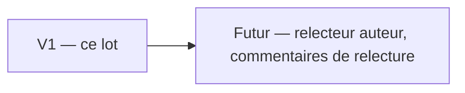

# PRD — Rôle relecteur et cloisonnement des rédacteurs

Statut : brouillon
Sources : [schema_bd.md](schema_bd.md) § Rôles, [securite-rgpd.md](securite-rgpd.md) §§ 5 et 7, [cahier-des-charges-techniques.md](cahier-des-charges-techniques.md) § 4.2

## 1. Problème

Aujourd'hui un rédacteur crée une histoire, la relit, la valide et la publie seul : le circuit `brouillon → relecture → valide → publie` existe en base mais aucun rôle ne le contrôle. Tous les rédacteurs voient et modifient toutes les histoires.

L'objectif est de distribuer des comptes rédacteur à des élèves volontaires. Un contenu publié sur un site de prévention doit être relu par une personne compétente. Un élève ne doit ni publier seul, ni toucher aux histoires d'un autre.

## 2. Objectifs

| ID | Objectif | Mesure de succès |
|---|---|---|
| O-01 | Aucune histoire n'est publiée sans un relecteur. | Un rédacteur ne peut atteindre ni `valide` ni `publie`, par l'interface comme par requête forgée. |
| O-02 | Un rédacteur ne voit que ses histoires. | Liste, URL directe, prévisualisation et scènes d'autrui renvoient 404. |
| O-03 | Toute action de relecture est traçable sans stocker de texte rédigé. | Les logs d'audit ne contiennent aucun titre de scène, dialogue ni texte de choix. |

## 3. Non-objectifs

- Le relecteur ne crée pas d'histoires (pour le moment).
- Pas de notification ni de commentaire de relecture entre rédacteur et relecteur.
- Pas de nouvel état : le circuit à quatre états reste tel quel.
- Pas de filtre de contenu sur les autres modèles que les histoires, les scènes et les choix.
- Les comptes `User` (nom, prénom, email, téléphone) restent journalisés comme aujourd'hui.

## 4. Utilisateurs

| Persona | Contexte | Besoin principal |
|---|---|---|
| Rédacteur | Élève volontaire. | Écrire ses histoires et les soumettre. |
| Relecteur | Personnel compétent. | Relire, corriger, valider, publier ou renvoyer en brouillon. |
| Administrateur | Gère les comptes. | Attribuer le rôle relecteur. |

## 5. User stories

| ID | En tant que | Je veux | Afin de | Priorité |
|---|---|---|---|---|
| US-01 | Administrateur | attribuer le rôle relecteur | confier la relecture à du personnel | P1 |
| US-02 | Rédacteur | ne voir que mes histoires | ne pas modifier le travail d'un autre | P1 |
| US-03 | Rédacteur | soumettre mon histoire en relecture | la faire relire | P1 |
| US-04 | Relecteur | voir, corriger et faire avancer toutes les histoires | garantir la qualité avant publication | P1 |
| US-05 | Relecteur | renvoyer une histoire en brouillon | la faire reprendre par son auteur | P1 |
| US-06 | Administrateur | retrouver qui a fait quoi sans lire de texte rédigé | auditer sans stocker de contenu | P1 |

## 6. Exigences fonctionnelles

| ID | Exigence | User story | Critère d'acceptation |
|---|---|---|---|
| F-01 | Le rôle `relecteur` existe, est attribuable par l'administrateur et donne accès au panel. | US-01 | AC-01 : Étant donné un compte sans rôle, quand l'admin lui attribue « Relecteur », alors il se connecte au panel. |
| F-02 | Un rédacteur voit, ouvre, prévisualise et parcourt uniquement les histoires dont il est l'auteur. | US-02 | AC-02 : Étant donné deux rédacteurs A et B, quand A ouvre l'URL d'une histoire de B, alors il reçoit 404 et la liste ne la contient pas. |
| F-03 | Un rédacteur modifie et supprime ses histoires uniquement à l'état `brouillon`. | US-02 | AC-03 : Étant donné une histoire de A en `relecture`, quand A ouvre sa page Infos ou tente une modification de scène, alors il reçoit 403. |
| F-04 | Un rédacteur ne peut faire passer son histoire que de `brouillon` à `relecture`. | US-03 | AC-04 : Étant donné une histoire de A en `brouillon`, quand A envoie `etat = publie`, alors le formulaire est refusé. |
| F-05 | Un relecteur voit toutes les histoires, les modifie dans tous les états, les supprime et choisit librement l'état parmi les quatre. | US-04, US-05 | AC-05 : Étant donné une histoire `publie`, quand le relecteur choisit `brouillon`, alors elle disparaît de l'API publique. |
| F-06 | Un relecteur ne crée pas d'histoire. | US-04 | AC-06 : Étant donné un relecteur, quand il ouvre la liste, alors le bouton « Nouvelle histoire » est absent et `/create` renvoie 403. |
| F-07 | Un rédacteur ne réutilise que des scènes de ses propres histoires. Un relecteur voit toutes les scènes. | US-02 | AC-07 : Étant donné une scène de B, quand A ouvre la réutilisation de scènes, alors elle n'y figure pas. |
| F-08 | Une scène utilisée par une autre histoire ne peut pas être supprimée. Elle peut être retirée de l'histoire courante. | US-02 | AC-08 : Étant donné une scène partagée, quand on tente de la supprimer, alors elle reste en base et un message l'explique. |
| F-09 | Le relecteur peut reprendre les histoires d'un compte supprimé, au même titre qu'un rédacteur. | US-01 | AC-09 : Étant donné un rédacteur auteur, quand l'admin le supprime en choisissant un relecteur comme repreneur, alors les histoires lui sont transférées. |
| F-10 | Chaque rôle a un guide rapide sur le tableau de bord. | US-03, US-04 | AC-10 : Étant donné un relecteur, quand il ouvre le tableau de bord, alors il voit « Guide rapide — Relecteur ». |
| F-11 | Les formulaires de saisie indiquent le nombre maximum de caractères. Le dialogue d'une scène est limité à 1 000 caractères. | US-03 | AC-11 : Étant donné un champ texte limité, quand l'écran s'affiche, alors la limite est écrite. |

## 7. Exigences non fonctionnelles

| ID | Catégorie | Exigence mesurable |
|---|---|---|
| NF-01 | Sécurité | Toute règle d'accès est appliquée côté serveur (policy, requête filtrée, validation `in`). Masquer un bouton ne suffit jamais. |
| NF-02 | Vie privée | Aucun titre de scène, dialogue de scène ni texte de choix dans le canal `audit`. Seuls l'identifiant et le nom des champs modifiés sont écrits. |
| NF-03 | Traçabilité | Changement d'état, rattachement de scène, retrait, déplacement, départ défini, sous-thèmes modifiés et accès refusé produisent chacun un événement `audit`. |
| NF-04 | Compatibilité | Aucun changement du contrat de l'API publique ni du front. |

## 8. Contraintes

| ID | Contrainte | Origine |
|---|---|---|
| C-01 | Rôles portés par une colonne et une contrainte SQL, pas de bibliothèque de permissions. | Technique ([schema_bd.md](schema_bd.md) § Choix) |
| C-02 | Les logs déjà écrits ne sont pas réécrits. Ils expirent à 365 jours. | Légale |

## 9. Périmètre par version

| Version | Contenu (IDs) |
|---|---|
| V1 | F-01 à F-11, NF-01 à NF-04 |
| Futur | Relecteur qui crée des histoires. Commentaires de relecture. |

## 10. Questions ouvertes

Aucune. Tranché le 2026-10-28 : le dialogue d'une scène est limité à 1 000 caractères (une mise en situation, pas un récit long).
