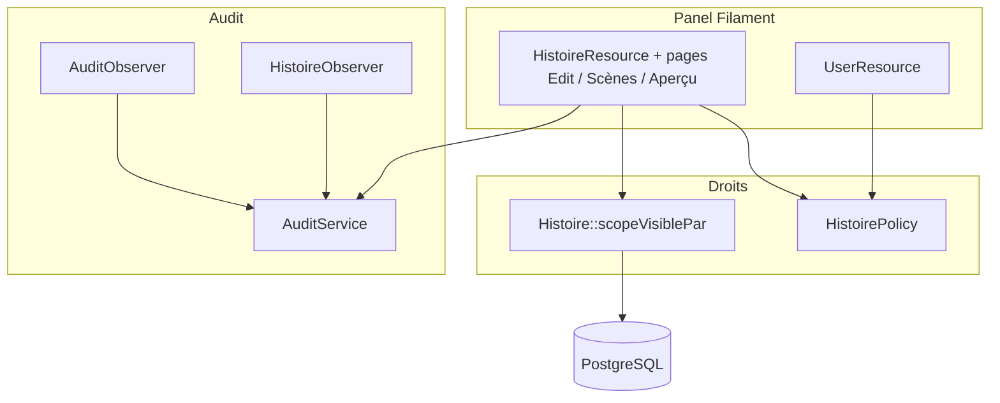
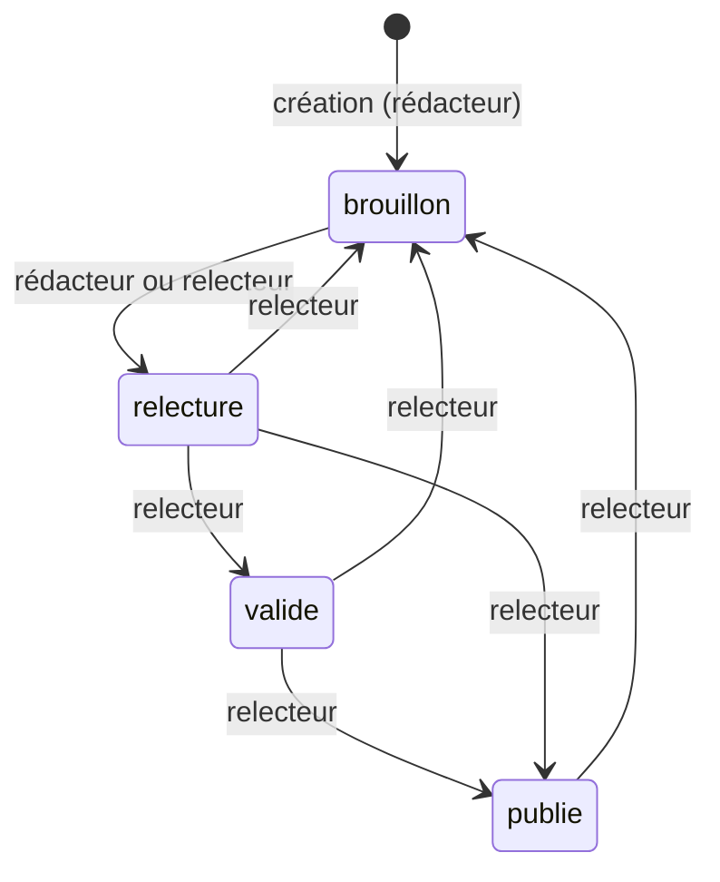

# TRD — Rôle relecteur et cloisonnement des rédacteurs

Statut : validé (2026-10-28)
Couvre : PRD F-01 … F-11, NF-01 … NF-04

## 1. Stack

Inchangée : Laravel 13, PHP 8.4, Filament 3, PostgreSQL 17. Voir [CLAUDE.md](../CLAUDE.md).

## 2. Architecture

- `HistoirePolicy` décide ce qu'un utilisateur peut faire sur une histoire donnée.
- `Histoire::scopeVisiblePar` restreint les requêtes : une histoire hors périmètre n'est jamais chargée (404, pas 403).
- `AuditService` écrit dans le canal `audit` et masque le contenu rédigé.

## 3. Modules et responsabilités

| Module / dossier | Responsabilité | Dépend de |
|---|---|---|
| `app/Enums/UserRole.php` | Ajoute `Relecteur`. | — |
| `database/migrations/` | Étend `users_role_check`. | — |
| `app/Policies/HistoirePolicy.php` | Droits par rôle, propriété et état. Méthode `etatsAccessibles`. | `UserRole`, `EtatHistoire` |
| `app/Policies/ScenePolicy.php`, `ChoixPolicy.php` | Alignées sur l'histoire. | `HistoirePolicy` |
| `app/Models/Histoire.php` | `scopeVisiblePar(User)`. | `UserRole` |
| `app/Filament/Resources/HistoireResource.php` | Requête filtrée, options d'état par rôle, suppression groupée filtrée. | Policy, scope |
| `app/Filament/Resources/HistoireResource/Pages/*` | Lecture seule, refus journalisés, événements pivot. | Policy, `AuditService` |
| `app/Services/AuditService.php` | Masque les champs de contenu. | — |
| `app/Observers/HistoireObserver.php` | Événement `Histoire.etat_change`. | `AuditService` |
| `app/Services/SuppressionCompteService.php` | Repreneur : rédacteur ou relecteur. | `UserRole` |
| `app/Filament/Widgets/` | Guide relecteur. | `UserRole` |

## 4. Intégrations externes

Aucune.

## 5. Exigences techniques

| ID | Exigence | Lien PRD | Vérification |
|---|---|---|---|
| T-01 | `UserRole::Relecteur` (`relecteur`, libellé « Relecteur »). Migration étendant `users_role_check`, réversible. | F-01 | `UserRoleTest` : insertion `relecteur` acceptée, `administrateur` refusée. |
| T-02 | `canAccessPanel()` accepte `Relecteur`. `UserResource::rolesAttribuables()` le propose. | F-01 | `UserResourceTest`. |
| T-03 | `Histoire::scopeVisiblePar(?User)` : relecteur sans filtre, rédacteur `user_id = id`, autre rôle ou `null` : aucune ligne. `HistoireResource::getEloquentQuery()` l'applique. | F-02 | Test : A ne trouve pas l'histoire de B (liste et URL). |
| T-04 | `HistoirePolicy` selon la matrice du § 7. Méthodes `etatsAccessibles(User, Histoire): list<EtatHistoire>` et `deleteAny`. | F-03 à F-06 | `HistoirePolicyTest`. |
| T-05 | Le `Select` d'état n'offre que les états accessibles. Règle `in` identique, validée côté serveur. | F-04 | Test : état forgé refusé. |
| T-06 | Pages Scènes et Aperçu : un rédacteur sur une histoire verrouillée voit sans pouvoir modifier. Les boutons d'écriture sont masqués. Les actions restent protégées par `update`. | F-03 | Test : action refusée, boutons absents. |
| T-07 | Réutilisation de scènes filtrée par `visiblePar`. Suppression d'une scène rattachée à une autre histoire refusée. | F-07, F-08 | Tests. |
| T-08 | `SuppressionCompteService` accepte un relecteur comme repreneur. | F-09 | `UserResourceTest`. |
| T-09 | `AuditService` ne journalise jamais `Scene.titre`, `Scene.dialogue_text`, `Choix.text_choix`. Il écrit `champs_modifies` (noms) à la place. `decrire()` n'écrit aucun libellé pour une scène. Aucune donnée personnelle de compte (e-mail, nom, prénom, téléphone) : identifiant seulement. | NF-02 | `AuditLogTest` : le texte ne figure nulle part dans le JSON. |
| T-10 | `Histoire.etat_change` avec `de` et `vers`, écrit après commit. | NF-03 | `AuditLogTest`. |
| T-11 | Événements `Histoire.scene_ajoutee`, `scene_retiree`, `scene_deplacee`, `depart_defini`, `sous_themes_modifies`, `Histoire.suppression_groupee` (`supprimees`, `refusees`). Identifiants uniquement. | NF-03 | Tests Livewire + `AuditLogTest`. |
| T-12 | Événement `Histoire.acces_refuse` (identifiant de l'histoire, motif) sur 404 hors périmètre (motif `hors_perimetre`) et sur 403 de page ou d'écriture de scène (motif `droit_refuse`, champ `capacite`). | NF-03 | Tests. |
| T-13 | Limite et mention du maximum sur `dialogue_text` (1 000), `titre` (255), `text_choix` (255). | F-11 | Test de validation. |

## 6. Gestion des erreurs et états

| Situation | Comportement |
|---|---|
| Histoire d'autrui | 404, événement `Histoire.acces_refuse` (motif `hors_perimetre`). |
| Histoire verrouillée (état ≠ `brouillon`, rédacteur auteur) | Page Infos : 403. Scènes et Aperçu : lecture seule. |
| État forgé | Erreur de validation sur le champ « État ». |
| Suppression d'une scène partagée | Notification d'avertissement, rien n'est supprimé. |
| Suppression groupée mixte | Seules les histoires supprimables partent. Une notification donne le nombre de refus. |

États et droits :

Le relecteur peut passer d'un état à n'importe quel autre. Le schéma montre le chemin nominal.

## 7. Sécurité et vie privée

Matrice des droits (pour un rédacteur, « ses histoires » = celles dont il est l'auteur) :

| Action | Rédacteur | Relecteur | Webmaster, admin |
|---|---|---|---|
| `viewAny` | oui | oui | non |
| `view` | ses histoires, tout état | toutes | non |
| `create` | oui | non | non |
| `update` | ses histoires en `brouillon` | toutes, tout état | non |
| `delete` | ses histoires en `brouillon` | toutes | non |
| États offerts | `brouillon`, `relecture` si l'histoire est en `brouillon` ; aucun sinon | les quatre | aucun |

- Défense en profondeur : requête filtrée (`getEloquentQuery`), policy, validation `in` du `Select`.
- Le masquage du contenu en log s'applique à `Scene` (`titre`, `dialogue_text`) et `Choix` (`text_choix`). Les autres modèles gardent le comportement actuel (valeurs tronquées à 200 caractères).
- `Histoire.titre` n'est pas masqué (décision : le périmètre vise les scènes et les choix). `decrire()` utilise `ref` pour une histoire.

## 8. Qualité

- Lint : `docker compose exec sc_back vendor/bin/pint --test`
- Analyse statique : `docker compose exec sc_back vendor/bin/phpstan analyse`
- Tests : `docker compose exec sc_back php artisan test`
- Vérification navigateur : passe `qa` en fin de lot, trois comptes (rédacteur A, rédacteur B, relecteur).

## 9. Décisions

| Date | Décision | Alternatives écartées | Raison |
|---|---|---|---|
| 2026-10-28 | Circuit à quatre états conservé (option A). `valide` = approuvé par le relecteur. | Retirer `valide` : migration de données pour un gain faible. | Aucun coût, liberté de publier plus tard. |
| 2026-10-28 | Histoire verrouillée pour le rédacteur hors `brouillon`. | Modification libre pendant la relecture : conflits de correction. | Le relecteur renvoie en `brouillon` pour une reprise. |
| 2026-10-28 | Le relecteur ne crée pas d'histoires. | Droit de création. | Demande explicite, « pour le moment ». |
| 2026-10-28 | Réutilisation limitée aux scènes de ses histoires. Suppression d'une scène partagée refusée. | Garder le partage global : un rédacteur détruirait le contenu d'un autre. | Cohérence avec le cloisonnement. |
| 2026-10-28 | Aucun texte rédigé en log ; nom des champs modifiés conservé. | Condensé ou hash du texte (écarté). | Règle explicite du porteur du projet. |
| 2026-10-28 | Périmètre du masquage : scènes et choix seulement (option A). | Tous les modèles : perd des valeurs utiles sur l'annuaire. | Lot cadré. |
| 2026-10-28 | Dialogue de scène limité à 1 000 caractères. | 2 000 (proposition initiale) : trop long pour une mise en situation. | Décision du porteur : une mise en situation, pas un récit. |
| 2026-10-28 | Journalisation des refus d'accès aux histoires. | Ne pas journaliser. | Détection des tentatives. |

## 10. Dette et risques connus

| Risque | Gravité | Effort | Conséquence si ignoré |
|---|---|---|---|
| Logs déjà écrits contenant des extraits de dialogues (200 premiers caractères). | Moyenne | Faible | Expirent à 365 jours. Purge manuelle possible sur le serveur si exigée. |
| Rattachements N-N des autres modèles (S-16) non tracés. | Basse | Moyen | Hors lot. Seuls ceux des histoires sont couverts. |
| `Contact` : e-mail et téléphone peuvent encore apparaître dans les valeurs journalisées. | Moyenne | Faible | Hors lot. |

## 11. Questions ouvertes

Aucune.
