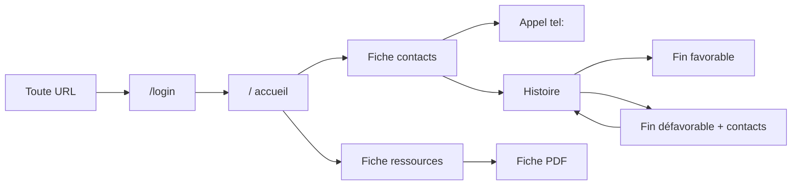
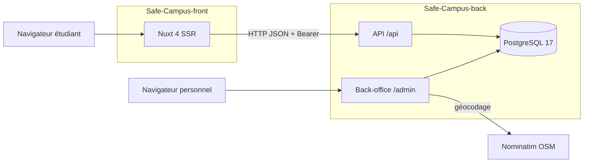

# Cahier des charges techniques — Safe Campus

Statut : brouillon (v1.1, 20/10/2026)

| Élément | Valeur |
|---|---|
| Projet | Safe Campus — SAE501 |
| Version | 1.1 — remplace la v1.0 du 07/10/2026 (PDF) |
| Périmètre | Safe-Campus-front (Nuxt 4) · Safe-Campus-back (Laravel 13 / Filament 3) |
| Documents liés | [Sécurité et RGPD](securite-rgpd.md) · [Maintenance évolutive 2025–2029](maintenance-evolutive-2025-2029.md) · [Schéma de base de données](schema_bd.md) · [Déploiement](deploiement.md) |

Ce fichier est la source de vérité. Les exports PDF sont générés à partir de lui.

**Changements depuis la v1.0** : l'hébergement Dokploy est abandonné, aucun hébergeur n'est retenu (§ 8.3). La police Syne est remplacée par Cabin (§ 7.2). Le suivi et la maintenance renvoient au document dédié (§ 13).

---

## 1. Contexte et présentation du projet

### 1.1 Porteur du projet

Safe Campus est réalisé dans le cadre de la SAE501 pour le campus de l'Université de la Nouvelle-Calédonie (UNC). Le périmètre fonctionnel est fourni par la SAE. Le périmètre technique est laissé au choix de l'équipe projet et fait l'objet du présent document.

### 1.2 Raisons du projet

Les étudiants confrontés à une addiction, à une souffrance psychique ou à des violences ne savent pas toujours vers qui se tourner. L'information existe (annuaires de structures d'aide, numéros d'urgence, associations). Elle est dispersée, peu adaptée au mobile et rarement contextualisée pour la Nouvelle-Calédonie.

Safe Campus centralise cette information dans une plateforme unique, sobre et bienveillante. Elle se consulte discrètement depuis un téléphone. Son contenu est maintenu par le personnel du campus, sans intervention d'un développeur.

### 1.3 Valeurs

- **Bienveillance et non-jugement** : ton neutre, aucune donnée personnelle demandée à l'étudiant.
- **Discrétion** : aucun compte individuel côté étudiant, aucune trace nominative de consultation.
- **Fiabilité** : contacts vérifiés, limités au territoire calédonien, mis à jour par le personnel.
- **Accessibilité** : conception mobile-first, lisibilité, contraste.

### 1.4 Thématiques couvertes

| Thème | Sous-thèmes (fiches) |
|---|---|
| Santé mentale | Détresse psychologique, crise suicidaire |
| Addictions | Alcool, cannabis et stupéfiants, tabac, jeux et écrans |
| Violences sexistes et sexuelles (VSS) | Violences sexuelles, violences intrafamiliales |
| Transverse | Urgences (SAMU 15, Police 17, Pompiers 18) |

Références techniques (`ref`) : voir [schema_bd.md § Taxonomie](schema_bd.md#taxonomie).

---

## 2. Objectifs du projet

### 2.1 Objectifs stratégiques

- Offrir aux étudiants un point d'entrée unique vers l'aide disponible sur le territoire.
- Rendre le personnel du campus autonome sur la mise à jour des contenus.
- Proposer un outil de prévention ludique (histoires interactives) en complément de l'information.

### 2.2 Objectifs opérationnels

| Objectif | Traduction technique attendue |
|---|---|
| Séparer contenu et présentation | Back = API JSON + back-office. Front = consommateur de l'API, aucun couplage de vues. |
| Gestion de contenu autonome | Back-office d'administration (CRUD, relations, médias) sans développement par écran. |
| Usage en mobilité | Interface mobile-first, rendu serveur (SSR) pour un premier affichage rapide. |
| Orientation rapide vers l'aide | Annuaire filtré par sous-thème, carte interactive, numéros cliquables. |
| Prévention | Lecteur d'histoires à embranchements, contacts affichés en fin défavorable. |
| Reproductibilité | Environnement 100 % conteneurisé (Docker), identique pour tous les développeurs. |
| Traçabilité | Journal d'audit des actions du back-office. |

### 2.3 Objectifs qualitatifs

| ID | Exigence |
|---|---|
| NF-01 | Temps de chargement perçu court sur réseau mobile : rendu SSR, payloads API minimaux. |
| NF-02 | Code typé, linté et testé. Conventions documentées dans chaque dépôt. |
| NF-03 | Conformité RGPD : minimisation des données, droit à l'effacement sur les contacts nommés. Détail : [securite-rgpd.md](securite-rgpd.md). |
| NF-04 | Back-office utilisable par un profil non technique (guides intégrés). |

---

## 3. Périmètre fonctionnel

Le système comprend deux applications indépendantes. Elles communiquent par une API REST JSON.

### 3.1 Site étudiant (Safe-Campus-front)

| ID | Fonctionnalité | Description |
|---|---|---|
| F-01 | Accès protégé | Accès après saisie d'un mot de passe partagé (« accès visiteur »). Sans jeton valide, toute page redirige vers `/login`. |
| F-02 | Accueil | Sections par thème, cartes par sous-thème (carrousel), barre de recherche avec synonymes (ex. « clope » → tabac). |
| F-03 | Fiche ressources | Article éditorial du sous-thème et fiches réflexives PDF téléchargeables. |
| F-04 | Fiche contacts | Annuaire des structures d'aide du sous-thème : téléphones cliquables, horaires, gratuité, anonymat, conditions d'accueil. Carte interactive des structures géolocalisées. |
| F-05 | Histoire interactive | Parcours à choix multiples, scène par scène. Fin favorable ou défavorable. En fin défavorable, affichage des contacts d'aide adaptés. Possibilité de recommencer. |
| F-06 | Navigation | Rail latéral (desktop), tiroir (mobile), bouton retour en haut, pied de page. |
| F-07 | Pages légales | Mentions légales et CGU. |

### 3.2 Back-office (Safe-Campus-back, `/admin`)

| ID | Fonctionnalité | Description |
|---|---|---|
| F-10 | Taxonomie | Gestion des thèmes et sous-thèmes : libellé, résumé, article, médias associés, activation. |
| F-11 | Annuaire | Gestion des contacts, de leurs téléphones et de leur rattachement ordonné aux sous-thèmes. Géocodage de l'adresse, ajustement sur carte, province. |
| F-12 | Médias | Bibliothèque d'images, vidéos, audios et documents PDF, avec libellé de recherche. |
| F-13 | Histoires | Création d'histoires, de scènes et de choix. Circuit éditorial brouillon → relecture → validé → publié. Prévisualisation. |
| F-14 | Comptes | Inscription publique validée par un administrateur. Attribution et retrait de rôle. Suppression avec transfert des histoires. |
| F-15 | Aide intégrée | Guides contextuels webmaster et rédacteur, sur le tableau de bord et par section. |
| F-16 | Audit | Journalisation des créations, modifications, suppressions, connexions et inscriptions. |

### 3.3 API

| Méthode et route | Rôle |
|---|---|
| `POST /api/login` | Authentifie le compte visiteur partagé et renvoie un jeton Bearer (Sanctum). |
| `GET /api/themes` | Thèmes et sous-thèmes en version légère (accueil) : ref, libellé, résumé, médias, référence d'histoire. |
| `GET /api/sous-themes/{ref}` | Détail d'un sous-thème : article, contacts actifs triés avec leurs téléphones, histoires publiées. |
| `GET /api/histoires/{ref}` | Graphe complet d'une histoire publiée (scènes, choix, contacts résolus), en une seule requête. |

Contrats détaillés : [schema_bd.md § Consommation API](schema_bd.md#consommation-api).

> Les trois routes `GET` sont aujourd'hui publiques : le jeton visiteur n'est vérifié que par le front. Correction prévue : mesure S-01 de [securite-rgpd.md](securite-rgpd.md#10-mesures-complémentaires-à-mettre-en-œuvre).

### 3.4 Hors périmètre de la version 1

- Module de **signalement** anonyme : modélisé en base (drapeau par sous-thème), interface reportée. Le circuit de traitement reste à définir avec la DNSI.
- Comptes étudiants individuels, commentaires, messagerie.
- Version anglaise (traduction FR/EN à étudier).
- Application mobile native : le site web responsive en tient lieu.

Ces évolutions sont planifiées dans [maintenance-evolutive-2025-2029.md](maintenance-evolutive-2025-2029.md).

---

## 4. Publics cibles

| Profil | Besoins | Accès |
|---|---|---|
| Étudiant | Trouver vite et discrètement une information fiable et un contact joignable. S'informer de façon ludique. | Site front, mot de passe visiteur partagé |
| Webmaster | Tenir à jour la taxonomie, les fiches, l'annuaire et les médias. | Back-office, rôle `webmaster` |
| Rédacteur | Écrire et faire valider des histoires interactives, illustrer les scènes. | Back-office, rôle `redacteur` |
| Administrateur | Valider les demandes de compte, gérer les rôles et les suppressions. | Back-office, rôle `admin` |

**Comportements attendus côté étudiant.** Consultation majoritairement sur smartphone, souvent dans un moment de stress. L'information essentielle (numéro, horaires, gratuité, anonymat) doit être visible sans recherche ni défilement excessif.

**Comportements attendus côté personnel.** Usage ponctuel sur poste de bureau, sans compétence technique. L'interface doit guider et empêcher les erreurs : champs obligatoires, valeurs contraintes, références générées automatiquement.

---

## 5. Contraintes et ressources disponibles

### 5.1 Contraintes budgétaires

| ID | Contrainte |
|---|---|
| C-01 | Projet académique sans budget de licence. Toute la pile repose sur des logiciels libres et des services gratuits : OpenStreetMap / Nominatim (cartographie, géocodage), Google Fonts, Heroicons. |

### 5.2 Contraintes techniques

| ID | Contrainte |
|---|---|
| C-02 | Deux dépôts Git indépendants, déployables séparément. |
| C-03 | Aucune dépendance installée sur le poste hôte : toutes les commandes s'exécutent dans les conteneurs. |
| C-04 | Le front ne détient aucune donnée métier : tout transite par l'API. |
| C-05 | Base relationnelle PostgreSQL. Intégrité garantie par contraintes (clés étrangères, unicité, CHECK). |
| C-06 | Géocodage Nominatim limité à 1 requête par seconde. Le volume de saisie est faible : contrainte acceptable. |

### 5.3 Contraintes réglementaires

| ID | Contrainte |
|---|---|
| C-07 | RGPD : aucune donnée personnelle collectée auprès des étudiants. Les données des référents nommés de l'annuaire doivent pouvoir être supprimées définitivement (suppression en cascade). |
| C-08 | Mentions légales et CGU publiées sur le site et sur le back-office. |
| C-09 | Mots de passe du back-office : 14 à 72 caractères, majuscule, minuscule, caractère spécial, absence dans les fuites connues (Have I Been Pwned, k-anonymat). |
| C-10 | Périmètre des données : Nouvelle-Calédonie uniquement. Les numéros métropolitains non joignables depuis la NC sont exclus. |

Détail : [securite-rgpd.md](securite-rgpd.md).

### 5.4 Contraintes humaines

Équipe étudiante réduite, temps contraint par le calendrier de la SAE. Le personnel du campus qui maintiendra le contenu n'a pas de profil technique.

### 5.5 Ressources disponibles

- Annuaire source des structures d'aide (fichier CSV), importé par des seeders idempotents (rejouables sans créer de doublon).
- Logo, illustrations (personnages par sous-thème), polices.
- Dépôts GitHub, Docker Desktop / WSL 2, VS Code.
- Images Docker de production prêtes (`docker-compose.prod.yml` dans chaque dépôt). Aucune plateforme d'hébergement n'est retenue à ce jour.

---

## 6. Arborescence et navigation du site

### 6.1 Site étudiant

| Route | Page |
|---|---|
| `/login` | Connexion visiteur (mot de passe partagé) |
| `/` | Accueil : thèmes, cartes de sous-thèmes, recherche |
| `/ressources/{theme}/{slug}` | Fiche ressources du sous-thème (article, PDF) |
| `/contact/{theme}/{slug}` | Annuaire et carte du sous-thème |
| `/histoire/{theme}/{slug}` | Histoire interactive du sous-thème, ou message d'attente si aucune histoire |
| `/mentions-legales` | Mentions légales |
| `/cgu` | Conditions générales d'utilisation |

### 6.2 Parcours utilisateurs attendus



- **Recherche d'aide** : accueil → carte du sous-thème → « Contact » → appel d'un numéro en un geste.
- **Information** : accueil (ou recherche « clope », « stress »…) → « Ressources » → lecture de l'article ou ouverture d'une fiche PDF.
- **Prévention** : fiche du sous-thème → « Suivre l'histoire » → choix successifs → fin favorable, ou fin défavorable avec contacts d'aide → recommencer ou revenir à la page d'origine.
- **Première visite** : toute URL → `/login` → retour automatique à la page demandée après connexion.

### 6.3 Back-office

| Section | Rôle autorisé |
|---|---|
| Tableau de bord + guide | `webmaster`, `redacteur` |
| Thèmes / Sous-thèmes | `webmaster` |
| Contacts / Téléphones | `webmaster` |
| Médias | `webmaster`, `redacteur` |
| Histoires / Scènes / Choix (+ prévisualisation) | `redacteur` |
| Utilisateurs | `admin` |
| `/admin/login`, `/admin/register` | Public |

---

## 7. Design et identité visuelle

### 7.1 Approche

Design **sur mesure** pour le site étudiant, sans template ni framework CSS. Le back-office utilise les composants Filament, personnalisés aux couleurs du projet.

### 7.2 Charte graphique

| Élément | Valeur |
|---|---|
| Couleur principale | `#1E466B` (bleu nuit) |
| Couleur d'accent | `#4260E6` |
| Fond / texte | `#F9F9F9` / `#0D0D0D` |
| Texte secondaire | `#6B7A99` |
| Titrage et corps de texte | Cabin 400 / 600 / 700 (Google Fonts) |
| Polices secondaires | Bebas Neue (Google Fonts). Almost Textual, déclarée en local (`@font-face`). |
| Icônes | Heroicons, style outline 24×24, trait 1,5 px, couleur héritée |
| Cartes | Rayon 20 px, ombre douce |

Le chargement depuis Google Fonts transmet l'adresse IP du visiteur à Google. Il est prévu d'héberger les polices localement : mesure S-08 de [securite-rgpd.md](securite-rgpd.md#10-mesures-complémentaires-à-mettre-en-œuvre).

### 7.3 Ergonomie et responsive

- Conception **mobile-first**, échelle typographique unique : racine 17 px, aucun texte lisible sous ~12,75 px.
- Navigation par tiroir sur mobile, rail latéral sur desktop.
- Numéros de téléphone en liens `tel:`. PDF ouverts dans un nouvel onglet.
- Contraste renforcé dans le back-office : bordures et séparateurs retintés en bleu de marque.
- Filigrane « prototype » tant que le site n'est pas en production.

### 7.4 Conventions d'intégration

- Aucun bloc `<style>` dans les composants. CSS dans `app/assets/css/` : `main.css`, un fichier par composant, un fichier par page.
- Nommage **BEM** (`.bloc__element--modificateur`) et variables CSS pour toute valeur partagée.
- Icônes SVG importées comme composants Vue (`vite-svg-loader`), jamais de tracé dupliqué.

Détail : `CLAUDE.md` et `README.md` de Safe-Campus-front.

---

## 8. Développement technique

### 8.1 Architecture générale

Architecture découplée (« headless ») : le back expose une API REST JSON et héberge le back-office. Le front est une application Nuxt rendue côté serveur, qui consomme l'API. Chaque dépôt a sa propre stack Docker. En développement, les deux stacks partagent le réseau Docker `scback` : le rendu serveur du front joint l'API par le nom de son conteneur.



| Couche | Technologie | Justification |
|---|---|---|
| Front | Nuxt 4.5, Vue 3.5, TypeScript, Vite | SSR pour un premier affichage rapide et un bon référencement. Routage par fichiers. Typage. |
| Cartographie | Leaflet + OpenStreetMap | Libre, sans clé API, léger. Chargé uniquement sur la page contact. |
| Back / API | Laravel 13, PHP 8.4 | Framework mature, ORM Eloquent, migrations, tests intégrés. |
| Back-office | Filament 3.3 | CRUD, formulaires et relations générés. Aucun écran à développer à la main. |
| Authentification API | Laravel Sanctum 4 (jetons Bearer) | Solution native Laravel, simple, sans OAuth. |
| Base de données | PostgreSQL 17 | Contraintes CHECK, index partiels, robustesse. |
| Géocodage | Nominatim (OSM) | Gratuit, sans clé. Conversion adresse → coordonnées à la saisie. |
| Conteneurisation | Docker / Docker Compose | Environnement identique pour tous, déploiement par image. |

### 8.2 Modèle de données

Le schéma est organisé en trois domaines, qui partagent un socle commun (`Media`, `User`).

| Domaine | Tables principales |
|---|---|
| Annuaire | `themes`, `sous_themes`, `contacts`, `telephones`, `medias`, `signalements`. Pivots `contact_sous_theme` (avec ordre), `media_sous_theme`, `media_theme`. |
| Histoires | `histoires`, `scenes`, `choix`. Pivots `histoire_sous_theme`, `histoire_scene` (scène initiale, ordre). |
| Administration | `users` (rôle), `personal_access_tokens` (Sanctum). |

Règles de modélisation imposées :

- Chaque entité de référence porte une `ref` stable (URL, seeders), distincte du libellé affiché, qui reste modifiable.
- Contraintes d'unicité sur les `ref` et sur l'email (insensible à la casse). Index partiel : une seule scène initiale par histoire.
- Index explicites sur toutes les clés étrangères : PostgreSQL ne les crée pas automatiquement.
- Énumérations stockées sans accent : rôle (`webmaster`, `redacteur`, `admin`, `visiteur`), état d'histoire (`brouillon`, `relecture`, `valide`, `publie`), issue de choix (`favorable`, `defavorable`), type de média, type de téléphone, province.
- Aucun lien entre `User` (compte d'administration) et `Contact` (ressource d'aide publiée).
- Désactivation (champ `actif`) pour l'éditorial, suppression définitive en cascade pour le RGPD.

Détail complet : [schema_bd.md](schema_bd.md).

### 8.3 Hébergement

**Aucune plateforme d'hébergement n'est retenue.** Le livrable est un jeu d'images Docker de production, déployables sur tout hôte Docker.

| ID | Exigence | État |
|---|---|---|
| T-01 | Images de production dédiées. Back : sans dépendances de développement, sans Xdebug, sans Adminer. Front : build multi-étapes (Nitro `node-server`), ne contenant que `.output/`. | Fait (`docker-compose.prod.yml`, `Dockerfile.prod`) |
| T-02 | Base PostgreSQL non exposée hors du réseau Docker. | Fait |
| T-03 | Reverse proxy et certificat TLS fournis en amont par l'hébergement retenu. Les conteneurs ne parlent que HTTP. | À fournir par l'hébergeur |
| T-04 | Volumes persistants pour `storage/app` (médias) et `storage/logs` (audit). | À faire |
| T-05 | Serveur d'application adapté à la production. L'image back lance aujourd'hui `php artisan serve`, serveur de développement mono-processus. | À faire |
| T-06 | Dimensionnement cible : 2 vCPU / 2 Go RAM / 40 Go SSD (50 à 500 utilisateurs simultanés). Minimum : 1 vCPU / 1 Go. | Estimation, voir [infra.md](infra.md) |

Procédure : [deploiement.md](deploiement.md).

### 8.4 Sécurité

| Exigence | Mise en œuvre |
|---|---|
| Accès au site étudiant | Middleware global côté front. Jeton Sanctum du compte visiteur stocké en cookie (`SameSite=Lax`). |
| Accès au back-office | Session Laravel (guard `web`). `canAccessPanel()` refuse tout compte sans rôle et le compte visiteur. |
| Autorisations | Une Policy Laravel par ressource, lue automatiquement par Filament : 403 et menu masqué. |
| Comptes | Inscription sans rôle, validation par un admin. Un admin ne peut ni modifier ni supprimer son propre compte. |
| Mots de passe | Politique forte + vérification des fuites connues. |
| Énumération de comptes | Message « en attente de validation » affiché uniquement après un mot de passe correct. |
| Configuration prod | `APP_DEBUG=false`, `LOG_LEVEL=error`, `APP_KEY` générée une seule fois, mot de passe BD aléatoire ≥ 20 caractères, utilisateur BD non superuser. |
| CORS | Origines autorisées limitées au domaine public du front. Prévu, pas encore effectif : mesure S-09. |
| Traçabilité | Canal `audit` JSON quotidien, conservation 365 jours, jamais de mot de passe ni de jeton. |

Mesures, écarts constatés et plan d'action : [securite-rgpd.md](securite-rgpd.md).

### 8.5 Gestion des rôles

Rôle unique par compte, porté par une colonne contrainte (enum + CHECK) et des Policies Laravel. Ce choix, sans dépendance supplémentaire, couvre le besoin de rôles fixes. Une évolution vers Spatie Permission / Filament Shield reste possible sans modifier les tables existantes. Comparatif : [schema_bd.md § Sur le point 6](schema_bd.md#sur-le-point-6).

### 8.6 Qualité et organisation du code

- Workflow **git flow** : branches `feature/*` fusionnées sur `dev` en `--no-ff`, `hotfix/*` depuis `main`. Messages de commit normalisés (`type(scope): résumé.`).
- Front : ESLint (`@nuxt/eslint`) et vérification de types (`nuxt typecheck` / `vue-tsc`) avant chaque fusion.
- Back : PHPUnit (20 fichiers de test), Larastan (analyse statique), Laravel Pint (formatage).
- Ordre des composants Vue : imports → props et emits → état → computed → fonctions.
- Aucune intégration continue (CI) : les vérifications sont lancées à la main.

---

## 9. Contenus à intégrer

| Contenu | Source / responsable | Mode d'intégration |
|---|---|---|
| Taxonomie (4 thèmes, 9 sous-thèmes) | Équipe projet | Migration (donnée structurelle, tous environnements) |
| Articles des fiches et résumés | Webmaster | Back-office (Sous-thèmes) |
| Annuaire des structures d'aide NC | Annuaire source CSV, vérifié | Seeder idempotent, puis back-office |
| Fiches réflexives PDF | Webmaster | Back-office (Médias, type `document`) |
| Illustrations, logos, personnages | Équipe projet / rédacteurs | Back-office (Médias) et assets du front |
| Histoires interactives | Rédacteurs | Back-office (Histoires), publication après validation |
| Mentions légales et CGU | Équipe projet, à compléter par l'établissement | Pages statiques front et back |
| Textes d'interface | Équipe projet | Recensés dans [textes-front.md](textes-front.md) |

> Les informations d'éditeur, d'hébergeur et de directeur de publication des mentions légales sont à compléter avant la mise en production.

---

## 10. Planning prévisionnel

| Phase | Période | Contenu |
|---|---|---|
| Cadrage | Avril 2026 | Analyse du besoin SAE, choix techniques, mise en place des dépôts et de l'environnement Docker |
| Conception | Mai – juillet 2026 | Modèle de données (MCD), contrats d'API, maquettes du site étudiant |
| Développement — annuaire | Juillet – août 2026 | Taxonomie, contacts, téléphones, médias, back-office, API annuaire, pages accueil / ressources / contact, carte |
| Développement — histoires | Septembre 2026 | Modèle histoires, éditeur et prévisualisation, lecteur interactif |
| Sécurisation et comptes | Septembre 2026 | Accès visiteur, inscription et validation, rôle admin, journal d'audit |
| Intégration | Septembre – octobre 2026 | Pages légales, refonte CSS, guides du back-office, retours de tests |
| Tests et recette | Octobre 2026 | Campagne de tests, correction des anomalies, validation |
| Mise en ligne | À fixer avec l'établissement | Choix de l'hébergeur, déploiement des images, reprise des contenus, formation |
| Suivi | Après mise en ligne | Voir [maintenance-evolutive-2025-2029.md](maintenance-evolutive-2025-2029.md) |

---

## 11. Tests et recette

### 11.1 Tests automatisés

| Niveau | Couverture attendue |
|---|---|
| API | Contrats de `/api/themes`, `/api/sous-themes/{ref}`, `/api/histoires/{ref}` : filtrage actif / publié, tri, 404 sur histoire non publiée |
| Base de données | Contraintes : taxonomie, contacts, médias, histoires, rôles, signalements |
| Back-office | Accès par rôle à chaque ressource, inscription, gestion des utilisateurs, prévisualisation |
| Audit | Écriture des événements, absence de secrets dans les journaux |
| Front | Lint et vérification de types sans erreur |

Les tests back s'exécutent dans une transaction annulée en fin de test, sur une base migrée et seedée.

```bash
docker compose exec sc_back php artisan test        # Safe-Campus-back
docker compose exec sc_front npm run lint           # Safe-Campus-front
docker compose exec sc_front npm run typecheck      # Safe-Campus-front
```

### 11.2 Scénarios de recette

| ID | Scénario | Résultat attendu |
|---|---|---|
| R-01 | Accès à une page sans être connecté | Redirection vers `/login`, puis retour à la page demandée |
| R-02 | Recherche « clope » sur l'accueil | La carte Tabac est proposée |
| R-03 | Ouverture d'une fiche contact | Contacts actifs triés, téléphones cliquables, carte avec marqueurs |
| R-04 | Ouverture d'une fiche PDF | Le document s'ouvre dans un nouvel onglet |
| R-05 | Parcours d'histoire jusqu'à une fin défavorable | Contacts d'aide du thème affichés, possibilité de recommencer |
| R-06 | Histoire non publiée appelée par son URL | Page indisponible (404 API) |
| R-07 | Inscription au back-office puis connexion | Message « en attente de validation ». Accès après attribution d'un rôle. |
| R-08 | Rédacteur ouvrant `/admin/contacts` | Accès refusé (403), entrée absente du menu |
| R-09 | Suppression d'un rédacteur auteur d'histoires | Transfert obligatoire à un autre rédacteur |
| R-10 | Désactivation d'un contact | Disparition immédiate du site étudiant |
| R-11 | Affichage mobile / tablette / desktop | Aucun défilement horizontal, navigation adaptée |

### 11.3 Critères de validation

- 100 % des tests automatisés au vert, lint et typecheck sans erreur.
- Tous les scénarios de recette validés sur Chrome, Firefox et Safari mobile.
- Aucune anomalie bloquante ou majeure ouverte.
- Retours des testeurs du back-office traités ou planifiés : [retours-tests.md](retours-tests.md).

---

## 12. Mise en ligne et formation

### 12.1 Processus de mise en ligne

1. Choisir l'hébergement (hôte Docker + reverse proxy TLS) et signer le contrat de sous-traitance.
2. Générer une seule fois `APP_KEY`. La saisir dans les variables d'environnement de l'hébergement avec les autres : `APP_URL`, base de données, CORS, compte admin initial, identifiants visiteur.
3. Configurer les volumes persistants (médias, journaux) et la sauvegarde de la base avant le premier déploiement.
4. Déployer le back, puis lancer les commandes post-déploiement : `package:discover`, `filament:upgrade`, `migrate --force`, `storage:link`. Jamais `db:seed` en production.
5. Déployer le front avec `NUXT_PUBLIC_API_BASE` pointant sur l'URL publique HTTPS de l'API.
6. Importer l'annuaire, vérifier les contenus, compléter les mentions légales, retirer le filigrane prototype.
7. Exécuter la recette (§ 11.2) sur l'environnement de production.

Détail des commandes et des variables : [deploiement.md](deploiement.md).

### 12.2 Formation des administrateurs

- Guides intégrés au tableau de bord (webmaster, rédacteur) et encarts d'aide par section.
- Session de prise en main par rôle : webmaster (fiches, contacts, médias), rédacteur (écriture, circuit de validation, prévisualisation), admin (validation des comptes, rôles, suppression).
- Documentation technique dans les dépôts : README, déploiement, schéma de base de données, infrastructure, maintenance.

---

## 13. Suivi et maintenance

Mises à jour, montées de version, sauvegardes, supervision et évolutions : [maintenance-evolutive-2025-2029.md](maintenance-evolutive-2025-2029.md).

Maintenance de la sécurité et gestion des violations de données : [securite-rgpd.md](securite-rgpd.md).

---

## 14. Critères de réussite

| Indicateur | Cible |
|---|---|
| Respect des délais | Livrables remis aux échéances de la SAE |
| Budget | Aucun coût de licence. Hébergement dans le dimensionnement prévu. |
| Site fonctionnel | Fonctionnalités F-01 à F-16 opérationnelles, recette validée |
| Performance | Premier affichage < 3 s en 4G. Une seule requête API par page. |
| Accès à l'aide | Un numéro d'aide joignable en 3 interactions maximum depuis l'accueil |
| Autonomie du personnel | Webmaster et rédacteur capables de publier sans intervention technique |
| Sécurité | Aucun accès non autorisé au back-office, aucun secret dans les journaux |
| Qualité | Tests, lint et typecheck au vert sur les deux dépôts |
| Satisfaction | Retours positifs des étudiants et du personnel testeurs |

---

## 15. Décisions

| Date | Décision | Alternatives écartées | Raison |
|---|---|---|---|
| 2026-07 | Rôles portés par une colonne contrainte + Policies | Spatie Permission + Filament Shield | Rôles fixes, aucune dépendance. Voir [schema_bd.md](schema_bd.md#sur-le-point-6). |
| 2026-07 | Coordonnées des contacts stockées (`latitude`, `longitude`) | Géocodage à la volée côté front | Une requête Nominatim à la saisie plutôt qu'à chaque affichage. |
| 2026-09-28 | Police Cabin pour le titrage et le corps | Syne | Commit `9c4a46a` du dépôt front. |
| 2026-10 | Abandon de Dokploy, hébergement non arrêté | Dokploy | Décision de l'équipe. Les images Docker restent portables. |

## 16. Questions ouvertes

1. Quel hébergeur et quelle offre (hôte Docker, reverse proxy TLS, sauvegardes) l'établissement retient-il ?
2. Qui porte la maintenance après la fin de la SAE, avec quel temps alloué ?
3. Quand la mise en ligne est-elle prévue ?
