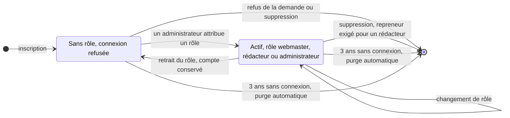
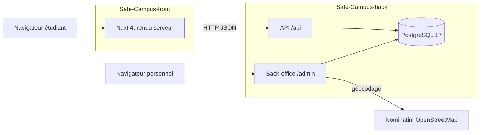
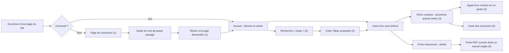
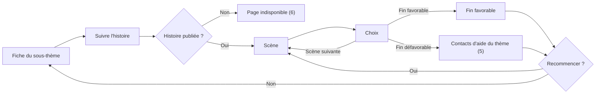
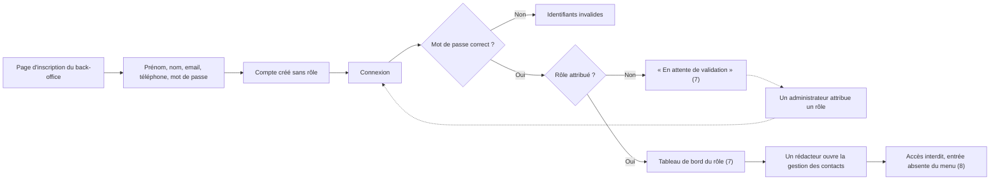
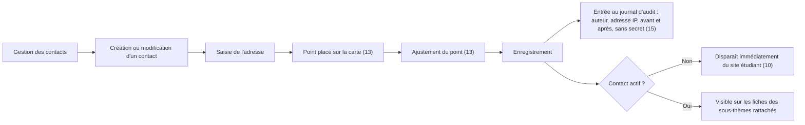
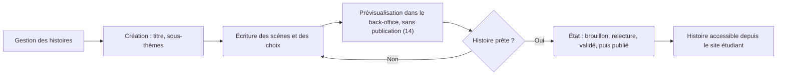
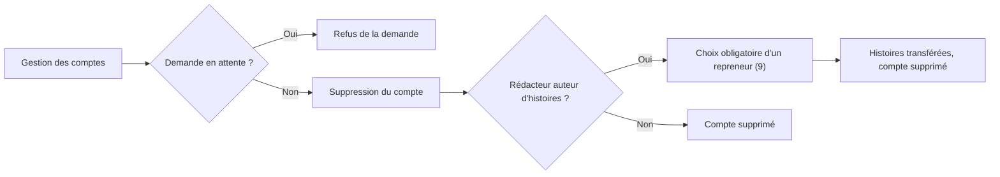
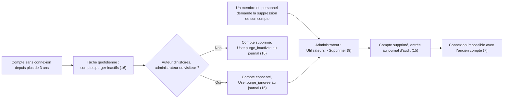
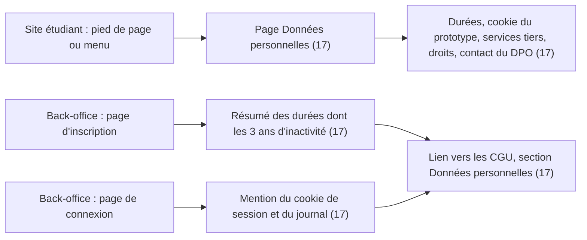

# Cahier des charges techniques — Safe Campus

| Élément | Valeur |
|---|---|
| Projet | Safe Campus — SAE501, Université de la Nouvelle-Calédonie |
| Date | 20/10/2026 |
| Périmètre | Site étudiant (Nuxt 4) · API et back-office (Laravel 13 / Filament 3) |
| Livrables | Site étudiant, back-office d'administration, API REST JSON, images Docker de production |

Les exigences sont classées en quatre familles :

- les **exigences fonctionnelles** décrivent ce que le système fait ;
- les **exigences non fonctionnelles** décrivent avec quelle qualité il le fait ;
- les **exigences d'exploitation** décrivent comment il est hébergé et maintenu ;
- les **contraintes** sont les limites imposées au projet.

Chaque exigence est vérifiée par un scénario de recette (section 11). Son état est donné au 20/10/2026 : conforme, partiel ou non conforme.

---

## 1. Contexte

Safe Campus est réalisé dans le cadre de la SAE501 pour le campus de l'Université de la Nouvelle-Calédonie. Le périmètre fonctionnel est fourni par la SAE. Le périmètre technique est laissé au choix de l'équipe projet.

Les étudiants confrontés à une addiction, à une souffrance psychique ou à des violences ne savent pas toujours vers qui se tourner. L'information existe, mais elle est dispersée, peu adaptée au mobile et rarement contextualisée pour la Nouvelle-Calédonie. Safe Campus la centralise dans une plateforme sobre, consultable discrètement depuis un téléphone. Le personnel du campus en maintient le contenu, sans développeur.

| Thème | Sous-thèmes (fiches) |
|---|---|
| Conduites addictives | Alcool, tabac, drogue |
| Santé mentale | Anxiété, dépression, burn-out |
| Violences | Violences sexistes, violences sexuelles, harcèlement |

### Objectifs

- Offrir aux étudiants un point d'entrée unique vers l'aide disponible sur le territoire.
- Rendre le personnel du campus autonome sur la mise à jour des contenus.
- Proposer un outil de prévention ludique (histoires interactives) en complément de l'information.

---

## 2. Acteurs

| Acteur | Besoin | Accès |
|---|---|---|
| Étudiant | Trouver vite et discrètement une information fiable et un contact joignable. Consultation sur smartphone, souvent dans un moment de stress. | Site étudiant public. Pendant les événements du prototype : portillon visiteur à mot de passe partagé. |
| Webmaster | Tenir à jour la taxonomie, les fiches, l'annuaire et les médias. | Back-office, rôle webmaster |
| Rédacteur | Écrire, illustrer et publier des histoires interactives. | Back-office, rôle rédacteur |
| Administrateur | Valider les demandes de compte, gérer les rôles et les suppressions. | Back-office, rôle administrateur |

Le personnel utilise le back-office ponctuellement, sur poste de bureau, sans compétence technique.

---

## 3. Exigences fonctionnelles

### 3.1 Site étudiant

| Exigence | Vérification | État |
|---|---|---|
| Le site n'est accessible qu'après saisie du mot de passe partagé. Toute page redirige vers la page de connexion, puis revient à la page demandée. | Scénario 1 | Conforme |
| L'accueil présente les thèmes en sections et les sous-thèmes en cartes. | Scénario 11 | Conforme |
| La recherche couvre thèmes et sous-thèmes et reconnaît des synonymes (« clope » → tabac). | Scénario 2 | Conforme |
| La fiche ressources affiche l'article du sous-thème et ses fiches PDF, ouvertes dans un nouvel onglet. | Scénario 4 | Conforme |
| La fiche contacts liste les structures actives du sous-thème, dans l'ordre éditorial : téléphones cliquables, horaires, gratuité, anonymat, conditions d'accueil. | Scénario 3 | Conforme |
| La fiche contacts affiche une carte des structures géolocalisées. | Scénario 3 | Conforme |
| L'histoire interactive se joue scène par scène. Une fin défavorable affiche les contacts d'aide du thème. Le joueur peut recommencer. | Scénario 5 | Conforme |
| Une histoire non publiée n'est pas accessible. | Scénario 6 | Conforme |
| Mentions légales et conditions générales d'utilisation sont publiées. | Scénario 12 | Partiel : éditeur, hébergeur et directeur de publication à compléter |

### 3.2 Back-office

| Exigence | Vérification | État |
|---|---|---|
| Gestion des thèmes et sous-thèmes : libellé, résumé, article, médias associés, activation. | Scénario 10 | Conforme |
| Gestion des contacts et de leurs téléphones, rattachement ordonné aux sous-thèmes. | Scénario 10 | Conforme |
| Géocodage de l'adresse d'un contact à la saisie, ajustement du point sur une carte. | Scénario 13 | Conforme |
| Bibliothèque de médias (image, vidéo, audio, document PDF) avec libellé de recherche. | Revue du back-office | Conforme |
| Gestion des histoires, scènes et choix. États : brouillon, relecture, validé, publié. | Scénario 6 | Conforme |
| Prévisualisation d'une histoire avant publication. | Scénario 14 | Conforme |
| Inscription publique. Le compte reste inactif jusqu'à l'attribution d'un rôle par un administrateur. | Scénario 7 | Conforme |
| Suppression d'un rédacteur avec transfert obligatoire de ses histoires. | Scénario 9 | Conforme |
| Suppression d'un compte par un administrateur sur demande de la personne (droit à l'effacement). | Scénario 9 | Conforme |
| Suppression automatique des comptes sans connexion depuis 3 ans (hors visiteur, administrateurs et auteurs d'histoires). | Scénario 16 | À valider en recette |
| Guides contextuels pour le webmaster et le rédacteur, sur le tableau de bord et par section. | Revue du back-office | Conforme |
| Journal d'audit : création, modification, suppression, connexion, échec de connexion, inscription. | Scénario 15 | Conforme |

### 3.3 API

| Route | Fonction | État |
|---|---|---|
| `POST /api/login` | Ouvre le portillon visiteur du prototype et renvoie un jeton d'accès. | Conforme |
| `GET /api/themes` | Thèmes et sous-thèmes en version légère, pour l'accueil. | Conforme |
| `GET /api/sous-themes/{ref}` | Détail d'un sous-thème : article, contacts actifs triés, téléphones, histoires publiées. | Conforme |
| `GET /api/histoires/{ref}` | Graphe complet d'une histoire publiée, en une seule requête. | Conforme |

### 3.4 Hors périmètre

- Module de signalement anonyme : modélisé en base, interface reportée. Le circuit de traitement est à définir avec la direction du numérique de l'établissement.
- Comptes étudiants individuels, commentaires, messagerie.
- Version anglaise.
- Application mobile native : le site responsive en tient lieu.

---

## 4. Matrice des droits

Une ressource refusée disparaît du menu du back-office. Appelée directement, elle répond « accès interdit ».

### 4.1 Accès

| Action | Anonyme | Visiteur | Webmaster | Rédacteur | Administrateur |
|---|---|---|---|---|---|
| Consulter le site étudiant | Oui ¹ | Oui | Oui ¹ | Oui ¹ | Oui ¹ |
| Appeler l'API de lecture | Oui ² | Oui | Oui | Oui | Oui |
| S'inscrire au back-office | Oui | Non | Non | Non | Non |
| Se connecter au back-office | Non | Non | Oui | Oui | Oui |
| Voir le guide du tableau de bord | Non | Non | Oui | Oui | Non |

¹ Le site est public. Pendant les événements du prototype, il faut d'abord passer le portillon visiteur (mot de passe partagé).
² L'API de lecture est publique par conception.

### 4.2 Contenus

| Ressource | Webmaster | Rédacteur | Administrateur |
|---|---|---|---|
| Thèmes | Créer, lire, modifier, supprimer | Aucun droit | Aucun droit |
| Sous-thèmes (fiches) | Créer, lire, modifier, supprimer | Aucun droit | Aucun droit |
| Contacts | Créer, lire, modifier, supprimer | Aucun droit | Aucun droit |
| Téléphones | Créer, lire, modifier, supprimer | Aucun droit | Aucun droit |
| Médias | Créer, lire, modifier, supprimer | Créer, lire, modifier, supprimer | Aucun droit |
| Histoires | Aucun droit | Créer, lire, modifier, supprimer | Aucun droit |
| Scènes | Aucun droit | Créer, lire, modifier, supprimer | Aucun droit |
| Choix | Aucun droit | Créer, lire, modifier, supprimer | Aucun droit |
| Prévisualiser une histoire | Non | Oui | Non |
| Changer l'état d'une histoire, jusqu'à « publié » | Non | Oui | Non |

Le circuit brouillon → relecture → validé → publié est déclaratif : le rédacteur fixe lui-même l'état. Aucun rôle distinct ne valide la publication.

### 4.3 Comptes du personnel

| Action | Webmaster | Rédacteur | Administrateur |
|---|---|---|---|
| Lister les comptes | Non | Non | Oui |
| Créer un compte | Non | Non | Non ³ |
| Attribuer ou retirer un rôle | Non | Non | Oui ⁴ |
| Modifier les coordonnées d'un compte | Non | Non | Oui ⁴ |
| Refuser une demande ou supprimer un compte | Non | Non | Oui ⁴ ⁵ |
| Modifier ou supprimer son propre compte | Non | Non | Non |
| Voir, modifier ou supprimer le compte visiteur | Non | Non | Non |

³ Aucun compte n'est créé à la main : tout passe par l'inscription, puis la validation.
⁴ Rôles attribuables : webmaster, rédacteur, administrateur. Le rôle visiteur ne s'attribue pas.
⁵ La suppression d'un rédacteur exige un repreneur pour ses histoires.

### 4.4 Cycle de vie d'un compte et de son rôle

Un compte sans rôle, qu'il vienne de s'inscrire ou qu'on lui ait retiré son rôle, ne peut pas se connecter. Seul un administrateur fait changer un compte d'état. Il ne peut jamais agir sur son propre compte ni sur le compte visiteur, qui reste hors de ce cycle.

Garde-fou : un administrateur ne pouvant agir sur son propre compte, le dernier administrateur ne peut pas disparaître.

Purge automatique : une tâche quotidienne supprime les comptes sans connexion depuis 3 ans. Un compte jamais connecté est jugé sur sa date d'inscription. Sont exclus le compte visiteur, les administrateurs et les auteurs d'histoires : ces derniers sont signalés au journal d'audit, et un administrateur choisit le repreneur avant de les supprimer.

---

## 5. Exigences non fonctionnelles

### 5.1 Performance

| Exigence | Vérification | État |
|---|---|---|
| Premier affichage en moins de 3 secondes sur réseau 4G, grâce au rendu côté serveur. | Mesure Lighthouse mobile | À mesurer |
| Une seule requête API par page. Une histoire est chargée en une requête. | Revue des appels réseau | Conforme |

### 5.2 Ergonomie

| Exigence | Vérification | État |
|---|---|---|
| Conception mobile-first. Aucun défilement horizontal du mobile au poste de bureau. | Scénario 11 | Conforme |
| Un numéro d'aide joignable en trois interactions au plus depuis l'accueil. | Scénario 3 | Conforme |
| Back-office utilisable sans compétence technique : guides, champs obligatoires, valeurs contraintes, références générées automatiquement. | Retours des testeurs | Conforme |

### 5.3 Sécurité

| Exigence | Vérification | État |
|---|---|---|
| Accès au back-office refusé à tout compte sans rôle et au compte visiteur. | Scénarios 7 et 8 | Conforme |
| Limitation des tentatives : 5 connexions et 2 inscriptions par minute au back-office. | Essais répétés | Conforme |
| Mots de passe du back-office : 14 à 72 caractères, majuscule, minuscule, caractère spécial, refus des mots de passe ayant fuité. Stockage haché. | Essai d'inscription | Conforme |
| Le message « en attente de validation » n'apparaît qu'après un mot de passe correct : il ne révèle pas si un email est inscrit. | Scénario 7 | Conforme |
| Cookies sécurisés en production, en-têtes HTTP de sécurité. | Inspection des réponses HTTP | Non conforme |
| Requêtes inter-domaines limitées au domaine du site étudiant. | Appel depuis un autre domaine | Non conforme |
| Téléversement des médias limité à une liste blanche de formats vérifiés sur le contenu (ni SVG ni HTML), 10 Mo par fichier. | Tests automatisés du back-office | Conforme |

### 5.4 Traçabilité

| Exigence | Vérification | État |
|---|---|---|
| Journal d'audit au format JSON, un fichier par jour, conservé 365 jours, sans mot de passe ni jeton. | Scénario 15 | Conforme |

### 5.5 Conformité RGPD

| Exigence | Vérification | État |
|---|---|---|
| Aucune donnée personnelle collectée auprès des étudiants. Aucun traceur d'audience. | Inventaire des cookies | Conforme |
| Les données d'un référent nommé de l'annuaire peuvent être effacées définitivement, en cascade. | Suppression d'un contact | Conforme |
| Les comptes du personnel inactifs depuis 3 ans sont supprimés automatiquement. | Scénario 16 | À valider en recette |
| Les durées de conservation et les droits sont communiqués aux personnes concernées : page « Données personnelles » du site, CGU du back-office, résumé sur les pages de connexion et d'inscription. | Scénario 17 | À valider en recette. Contenu à faire valider par le DPO |
| Aucune ressource tierce non nécessaire chargée par le navigateur : polices hébergées sur le serveur. | Revue des requêtes réseau | Non conforme : polices chargées depuis Google |

### 5.6 Maintenabilité

| Exigence | Vérification | État |
|---|---|---|
| Lint, vérification de types et tests au vert avant chaque fusion. | Commandes de qualité | Partiel : lancées à la main, sans intégration continue |
| Environnement de développement entièrement conteneurisé, identique pour tous. | Démarrage par `docker compose up -d` | Conforme |

---

## 6. Contraintes

| Nature | Contrainte |
|---|---|
| Budgétaire | Aucun budget de licence : logiciels libres et services gratuits uniquement (OpenStreetMap, Nominatim, Heroicons). |
| Technique | Deux dépôts indépendants, déployables séparément : Safe-Campus-front et Safe-Campus-back. |
| Technique | Le site étudiant ne détient aucune donnée métier : tout transite par l'API. |
| Technique | Base relationnelle PostgreSQL. Intégrité garantie par contraintes : clés étrangères, unicité, contrôles de valeur. |
| Technique | Géocodage Nominatim limité à une requête par seconde. Acceptable vu le faible volume de saisie. |
| Réglementaire | RGPD : minimisation des données, droit à l'effacement. |
| Réglementaire | Données limitées à la Nouvelle-Calédonie. Les numéros métropolitains non joignables depuis le territoire sont exclus. |
| Humaine | Équipe étudiante réduite, calendrier de la SAE. Personnel de maintenance des contenus sans profil technique. |

---

## 7. Architecture technique

Architecture découplée : le back expose une API REST JSON et héberge le back-office. Le site étudiant est une application Nuxt rendue côté serveur, qui consomme l'API.

| Couche | Technologie | Justification |
|---|---|---|
| Site étudiant | Nuxt 4, Vue 3, TypeScript | Rendu côté serveur pour un premier affichage rapide. Routage par fichiers. Typage. |
| Cartographie | Leaflet + OpenStreetMap | Libre, sans clé API, léger. Chargé uniquement sur la fiche contacts. |
| API | Laravel 13, PHP 8.4 | Framework mature : accès aux données, migrations, tests intégrés. |
| Back-office | Filament 3 | Écrans de gestion générés depuis les modèles. Aucun écran développé à la main. |
| Authentification API | Laravel Sanctum, jeton d'accès | Solution native Laravel, sans protocole de délégation externe. |
| Autorisations | Colonne de rôle contrainte + une règle d'autorisation par ressource | Rôles fixes, aucune dépendance supplémentaire. |
| Base de données | PostgreSQL 17 | Contrôles de valeur, index partiels. |
| Géocodage | Nominatim | Gratuit, sans clé. Adresse convertie en coordonnées à la saisie. |
| Conteneurisation | Docker, Docker Compose | Environnement identique pour tous, déploiement par image. |

### Modèle de données

| Domaine | Tables principales |
|---|---|
| Annuaire | `themes`, `sous_themes`, `contacts`, `telephones`, `medias`, `signalements` |
| Histoires | `histoires`, `scenes`, `choix` |
| Administration | `users` (avec rôle), `personal_access_tokens` (jetons) |

Règles de modélisation :

- Chaque entité de référence porte une référence stable (URL, import), distincte du libellé affiché, qui reste modifiable.
- Unicité des références et des emails. Une seule scène initiale par histoire.
- Index explicite sur chaque clé étrangère.
- Aucun lien entre les comptes du personnel et les structures d'aide publiées.
- Champ « actif » pour retirer un contenu du site sans le supprimer. Suppression définitive en cascade pour l'effacement RGPD.

---

## 8. Exigences d'exploitation

Aucun hébergeur n'est retenu. Le livrable est un jeu d'images Docker de production, déployables sur tout hôte Docker.

| Exigence | État |
|---|---|
| Images de production dédiées, sans outils de développement ni de débogage. Le site étudiant ne contient que son build. | Conforme |
| Base de données non exposée hors du réseau Docker interne. | Conforme |
| HTTPS assuré par un reverse proxy et un certificat fournis par l'hébergement. | À fournir par l'hébergeur |
| Volumes persistants pour les médias et les journaux. | Non conforme : un redéploiement les efface |
| Serveur d'application de production (PHP-FPM ou équivalent). | Non conforme : serveur de développement `artisan serve` |
| Conteneurs exécutés avec un utilisateur non administrateur. | Partiel : back conforme, site étudiant exécuté en administrateur |
| Images de production sans portillon visiteur (compte, page de connexion, middleware). | Non conforme : les images exigent encore le compte visiteur, à adapter au lancement officiel |
| Sauvegarde quotidienne de la base et des médias, stockée hors du serveur, restauration testée chaque trimestre. | Non conforme |
| Supervision de la disponibilité et des erreurs, avec alertes. | Non conforme |
| Dimensionnement : 2 processeurs virtuels, 2 Go de mémoire, 40 Go de disque pour 50 à 500 utilisateurs simultanés. Minimum : 1 processeur virtuel, 1 Go. | Estimation |

---

## 9. Contenus à intégrer

| Contenu | Responsable | Mode d'intégration |
|---|---|---|
| Taxonomie (3 thèmes, 9 sous-thèmes) | Équipe projet | Livrée avec l'application |
| Articles et résumés des fiches | Webmaster | Back-office |
| Annuaire des structures d'aide (source CSV vérifiée) | Équipe projet, puis webmaster | Import initial, puis back-office |
| Fiches réflexives PDF | Webmaster | Back-office (médias) |
| Illustrations et logos | Équipe projet | Back-office et application |
| Histoires interactives | Rédacteurs | Back-office |
| Mentions légales et conditions générales d'utilisation | Équipe projet, complétées par l'établissement | Pages du site et du back-office |

---

## 10. Planning

| Phase | Période | Contenu |
|---|---|---|
| Cadrage | Avril 2026 | Analyse du besoin, choix techniques, dépôts, environnement Docker |
| Conception | Mai – juillet 2026 | Modèle de données, contrats d'API, maquettes |
| Développement — annuaire | Juillet – août 2026 | Taxonomie, contacts, médias, back-office, API, pages accueil / ressources / contacts, carte |
| Développement — histoires | Septembre 2026 | Modèle, éditeur, prévisualisation, lecteur interactif |
| Sécurisation et comptes | Septembre 2026 | Accès visiteur, inscription validée, rôle administrateur, journal d'audit |
| Intégration | Septembre – octobre 2026 | Pages légales, refonte graphique, guides du back-office |
| Recette | Octobre 2026 | Campagne de tests, corrections, validation |
| Mise en ligne | À fixer avec l'établissement | Choix de l'hébergeur, déploiement, reprise des contenus, formation |

---

## 11. Recette

### 11.1 Parcours de recette

Chaque parcours se rejoue de bout en bout. Les numéros entre parenthèses sont les scénarios cités dans la colonne « Vérification » des exigences : l'étape marquée doit produire le résultat indiqué.

#### Parcours 1 — Étudiant : accès et recherche d'aide

#### Parcours 2 — Étudiant : histoire interactive

#### Parcours 3 — Personnel : inscription et accès au back-office

#### Parcours 4 — Webmaster : mise à jour de l'annuaire

#### Parcours 5 — Rédacteur : écriture et publication d'une histoire

#### Parcours 6 — Administrateur : suppression d'un compte

#### Parcours 7 — Conservation des comptes : demande d'effacement et purge à 3 ans

#### Parcours 8 — Information sur les données personnelles

#### Contrôles hors parcours

- **(11)** Affichage sur mobile, tablette et poste de bureau : aucun défilement horizontal, navigation adaptée.
- **(12)** Mentions légales, conditions générales d'utilisation et page Données personnelles : pages complètes, sans champ à compléter. La page Données personnelles est accessible sans mot de passe visiteur.

### 11.2 Critères de validation

- Tests automatisés, lint et vérification de types au vert sur les deux dépôts.
- Les huit parcours et les deux contrôles validés sur Chrome, Firefox et Safari mobile.
- Aucune anomalie bloquante ou majeure ouverte.
- Toutes les exigences d'exploitation conformes avant la mise en production.

---

## 12. Mise en ligne et formation

1. Choisir l'hébergement (hôte Docker, reverse proxy, certificat) et signer le contrat de sous-traitance.
2. Générer une seule fois la clé de chiffrement de l'application et saisir les variables d'environnement.
3. Créer les volumes persistants et la sauvegarde avant le premier déploiement.
4. Déployer le back, puis lancer les migrations. Aucune donnée de démonstration en production.
5. Déployer le site étudiant, pointé sur l'adresse publique HTTPS de l'API.
6. Importer l'annuaire, vérifier les contenus, compléter les mentions légales, retirer le filigrane « prototype ».
7. Rejouer la recette sur l'environnement de production.

Formation : guides intégrés au back-office, puis une session de prise en main par rôle (webmaster, rédacteur, administrateur).

---

## 13. Points à arrêter avec l'établissement

1. Hébergeur et offre retenus (hôte Docker, reverse proxy, sauvegardes).
2. Porteur de la maintenance après la SAE et temps alloué.
3. Date de mise en ligne.
