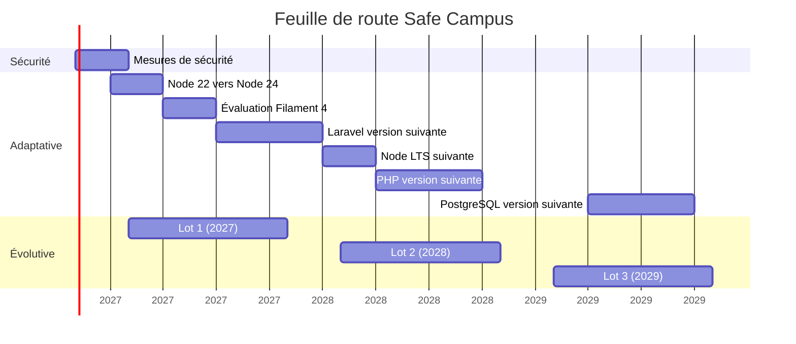

# Maintenance évolutive 2025–2029 — Safe Campus

| Élément | Valeur |
|---|---|
| Projet | Safe Campus — SAE501, Université de la Nouvelle-Calédonie |
| Date | 20/10/2026 |
| Période | 2025–2026 : réalisation. 2027–2029 : maintenance. |

Les dates de fin de support sont à revérifier à chaque revue trimestrielle. Une ligne marquée « à vérifier » n'a pas de source confirmée à la date du document.

---

## 1. Types de maintenance

| Type | Objet | Exemple Safe Campus |
|---|---|---|
| Corrective | Corriger une anomalie constatée | Bug signalé en recette, faille de sécurité |
| Préventive | Éviter une anomalie future | Mises à jour de dépendances, sauvegardes, supervision |
| Adaptative | Suivre l'évolution de l'environnement | Montée de version Node, PHP, Laravel, PostgreSQL |
| Évolutive | Ajouter ou modifier une fonctionnalité | Module de signalement, version anglaise |

---

## 2. Inventaire technique

État au 20/10/2026. Sources : `Safe-Campus-back/composer.json`, `Safe-Campus-front/package.json`, Dockerfiles.

| Composant | Version | Rôle |
|---|---|---|
| PHP | 8.4 | Runtime backend |
| Laravel | 13 | Framework backend |
| Filament | 3.3 | Back-office |
| Laravel Sanctum | 4 | Authentification API |
| PostgreSQL | 17 | Base de données |
| Nuxt | 4.5 | Framework frontend |
| Vue | 3.5 | Bibliothèque UI |
| Vue Router | 5 | Routage front |
| TypeScript | 5.7 | Typage front |
| Node.js | 22 (images `node:22`, `node:22-slim`) | Runtime frontend |
| Leaflet | 1.9 | Cartographie |

---

## 3. Calendrier de fin de support

| Composant | Fin de support | Statut au 20/10/2026 | Urgence |
|---|---|---|---|
| Node.js 22 | 30/04/2027 | Maintenance LTS | À planifier : migration au premier trimestre 2027 |
| Laravel 13 | Correctifs jusqu'au 3e trimestre 2027, sécurité jusqu'au 17/03/2028 | Support actif | À suivre |
| PHP 8.4 | 31/12/2028 | Support actif | À suivre |
| PostgreSQL 17 | 08/11/2029 | Support actif | Aucune |
| Node.js 24 (cible) | 30/04/2028 — à vérifier | LTS | Prévoir la LTS suivante en 2028 |
| Nuxt 4 | Inconnu — à vérifier | Version courante | À suivre : annonce de Nuxt 5 |
| Filament 3 | Inconnu — à vérifier | Filament 4 publié | À planifier : évaluation de la migration en 2027 |

---

## 4. Bilan 2025–2026 — réalisation

| Phase | Période | Réalisé |
|---|---|---|
| Cadrage | Avril 2026 | Dépôts, environnement Docker, choix techniques |
| Conception | Mai – juillet 2026 | MCD, contrats d'API, maquettes |
| Annuaire | Juillet – août 2026 | Taxonomie, contacts, médias, API annuaire, pages accueil / ressources / contact, carte |
| Histoires | Septembre 2026 | Modèle, éditeur, prévisualisation, lecteur interactif |
| Sécurisation | Septembre 2026 | Accès visiteur, inscription validée, rôle admin, journal d'audit |
| Intégration | Septembre – octobre 2026 | Pages légales, refonte CSS, migration Nuxt 4, police Cabin, guides du back-office |
| Recette | Octobre 2026 | Campagne de tests en cours |

Reste avant mise en production : les mesures de sécurité complémentaires, les actions de conformité RGPD et le choix de l'hébergeur.

---

## 5. Feuille de route 2026–2029

| Période | Action | Type | Déclencheur |
|---|---|---|---|
| 4e trimestre 2026 | Réaliser les mesures de sécurité de priorité haute : jeton exigé sur l'API, limitation des connexions visiteur, durée de vie des jetons, volumes et sauvegardes, variables du compte visiteur, serveur d'application de production | Corrective | Bloquant pour la mise en production |
| 4e trimestre 2026 | Activer Dependabot ou Renovate sur les deux dépôts | Préventive | Aucun outil de veille en place |
| 4e trimestre 2026 | Mettre en place une CI : lint, typecheck, tests, build des images | Préventive | Aucune CI ; vérifications à la main |
| 1er trimestre 2027 | Migrer Node 22 → Node 24 (images Docker du front) | Adaptative | EOL Node 22 au 30/04/2027 |
| 2e trimestre 2027 | Évaluer la migration Filament 3 → 4 | Adaptative | Support Filament 3 à vérifier |
| 2e semestre 2027 | Migrer Laravel 13 → version suivante | Adaptative | Fin des correctifs Laravel 13, sécurité jusqu'au 17/03/2028 |
| 1er trimestre 2028 | Migrer vers la LTS Node suivante | Adaptative | EOL Node 24 (à vérifier) |
| 2e et 3e trimestres 2028 | Migrer PHP 8.4 → version suivante | Adaptative | EOL PHP 8.4 au 31/12/2028 |
| 2e et 3e trimestres 2029 | Migrer PostgreSQL 17 → version suivante (`pg_dump` / `pg_restore` ou `pg_upgrade`) | Adaptative | EOL PostgreSQL 17 au 08/11/2029 |
| Mensuel | Revue des dépendances mineures Composer / npm | Préventive | — |
| Trimestriel | Test de restauration, revue des comptes, revue des dates EOL | Préventive | — |
| Annuel (rentrée) | Rotation du mot de passe visiteur, révocation des jetons | Préventive | Politique de sécurité |

---

## 6. Évolutions fonctionnelles

Candidates issues du périmètre reporté de la v1, des retours de tests et des points ouverts du schéma. Le découpage en lots est une proposition à arbitrer avec l'établissement.

| Évolution | Origine | Effort estimé | Lot proposé |
|---|---|---|---|
| Module de signalement anonyme : état de traitement, routage, protection contre le spam | Périmètre reporté de la version 1 | 2 à 3 jours | 2027 — dépend de la direction du numérique |
| Version anglaise du site et du back-office | Périmètre reporté de la version 1, retours de tests | 2 à 3 jours | 2028 |
| Horaires structurés (« ouvert maintenant ») | Modèle de données | 1 jour | 2028 |
| Recherche des contacts | Inventaire des textes du site | 1 jour | 2027 |
| Page « C'est quoi ? » de l'accueil éditable depuis le back-office | Inventaire des textes du site | Une demi-journée | 2027 |
| Guide du back-office découpé par section, explication du rattachement d'un média ou d'un contact | Retours de tests | Une demi-journée | 2027 |
| Fiches réflexives PDF (contenu à produire) | Inventaire des textes du site | Contenu | 2027 |
| Contrôle en base de la cohérence entre fin de parcours et issue d'un choix | Modèle de données | Moins de 2 heures | 2027 |
| Partage d'une scène entre histoires avec des choix propres à chacune | Modèle de données | 2 à 3 jours | 2029 — si le besoin apparaît |

---

## 7. Sauvegarde et restauration

À mettre en place avant la mise en production. Aucune stratégie n'existe dans les dépôts : seul le volume `scback-pgsql-prod` est déclaré.

| Élément | Cible |
|---|---|
| Base | `pg_dump` quotidien |
| Médias | Copie quotidienne du volume `storage/app` |
| Rétention | 30 jours glissants |
| Emplacement | Hors du serveur applicatif |
| Test de restauration | Trimestriel, sur un environnement séparé |
| Avant migration | Sauvegarde manuelle obligatoire avant tout `migrate --force` |

---

## 8. Supervision

Rien en place. À définir avec l'hébergeur retenu :

- Disponibilité : sonde HTTP sur le front et sur `/` du back (qui renvoie un JSON de statut).
- Erreurs applicatives : `storage/logs/laravel.log` (niveau `error` en production), avec alerte.
- Ressources : CPU, RAM, disque (volume PostgreSQL et médias).
- Sécurité : échecs de connexion répétés dans le journal `audit`.

---

## 9. Processus de maintenance

- **Correctif** : branche `hotfix/*` depuis `main`, fusion sur `main` et `dev`.
- **Évolution** : branche `feature/*` depuis `dev`, fusion `--no-ff` après validation.
- **Avant fusion** : tests back, lint et typecheck front au vert.
- **Mise en production** : sauvegarde, déploiement des images, commandes post-déploiement, recette de non-régression.
- **Contenus** : vérification semestrielle de l'annuaire (numéros, horaires) par le webmaster.

---

## 10. Risques

| Risque | Gravité | Probabilité | Mesure |
|---|---|---|---|
| Premier déploiement en échec : `VISITEUR_PASSWORD` non transmis au conteneur | Bloquant | Certaine en l'état | Transmettre les identifiants visiteur au conteneur |
| Serveur `artisan serve` en production : mono-processus, non prévu pour la charge | Élevé | Élevée | Serveur d'application de production |
| Perte des médias et journaux à chaque redéploiement (pas de volume) | Élevé | Certaine en l'état | Volumes persistants |
| Aucune sauvegarde définie | Élevé | Élevée si mise en prod sans correction | Sauvegarde (section 7) |
| API de lecture accessible sans jeton | Moyen | Élevée | Jeton exigé sur l'API |
| Aucun porteur de maintenance après la SAE | Élevé | Élevée | Point à arrêter n° 1 |
| Absence de CI : régressions non détectées | Moyen | Moyenne | Feuille de route, 4e trimestre 2026 |
| Dépendances obsolètes sans veille automatique | Moyen | Moyenne | Dependabot / Renovate |

---

## Points à arrêter avec l'établissement

1. Qui maintient Safe Campus après la fin de la SAE, avec quel temps alloué ?
2. Quel niveau de service (SLA, *Service Level Agreement*) est attendu : délai de correction d'une anomalie bloquante, disponibilité cible ?
3. Quel budget l'établissement prévoit-il pour l'hébergement et la maintenance ?
