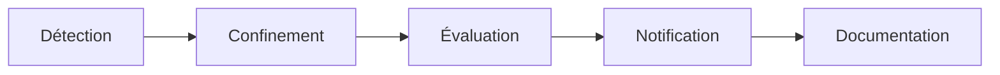

# Documentation sécurité et RGPD — Safe Campus

Statut : brouillon (v1.1, 20/10/2026)

| Élément | Valeur |
|---|---|
| Projet | Safe Campus — SAE501 |
| Version | 1.1 — remplace la v1.0 du 07/10/2026 (PDF) |
| Périmètre | Site étudiant (Nuxt 4), API et back-office (Laravel 13 / Filament 3), base PostgreSQL 17, images Docker de production |
| Documents liés | [Cahier des charges techniques](cahier-des-charges-techniques.md) · [Schéma de base de données](schema_bd.md) · [Déploiement](deploiement.md) · [Maintenance évolutive](maintenance-evolutive-2025-2029.md) |

Ce fichier est la source de vérité. Les exports PDF sont générés à partir de lui.

**Changements depuis la v1.0**
- Dokploy est retiré : l'hébergeur n'est pas désigné.
- Le conteneur front tourne en root, contrairement à ce qu'affirmait le § 8.
- Les mesures S-10 à S-14 sont ajoutées. Elles ont été constatées dans le code le 20/10/2026.
- Les polices chargées depuis Google Fonts sont Cabin et Bebas Neue.

Plan :
- Partie A, sécurité : § 1 à 10.
- Partie B, RGPD : § 11 à 18.

---

# Partie A — Sécurité

## 1. Objet et périmètre

Ce document décrit les mesures de sécurité de Safe Campus et la manière dont l'application traite les données personnelles. Il sert de référence à l'équipe projet, à l'établissement qui exploitera la plateforme et à son délégué à la protection des données (DPO).

Il couvre les deux applications du projet :

- **Safe-Campus-front** : site consulté par les étudiants.
- **Safe-Campus-back** : API REST, back-office d'administration (`/admin`) et base de données.

### 1.1 Principes directeurs

- **Protection dès la conception** : l'étudiant n'a ni compte, ni formulaire, ni suivi d'audience. Il n'y a donc aucune donnée sur lui à protéger.
- **Moindre privilège** : chaque membre du personnel n'accède qu'aux sections nécessaires à son rôle.
- **Défense en profondeur** : contrôles au niveau de l'interface, de l'application (Policies) et de la base (contraintes).
- **Traçabilité** : toute action du back-office est journalisée, sans jamais enregistrer de secret.

### 1.2 Cadre réglementaire

Le projet prend comme référentiel le RGPD (règlement UE 2016/679) et la loi Informatique et Libertés. La plateforme est exploitée en Nouvelle-Calédonie, où les règles applicables aux données personnelles présentent des spécificités.

> Le régime juridique exact applicable en Nouvelle-Calédonie doit être confirmé par le DPO de l'Université de la Nouvelle-Calédonie avant la mise en production.

---

## 2. Architecture et surfaces d'exposition

| Composant | Exposition | Protection |
|---|---|---|
| Site étudiant (Nuxt, SSR) | Public, HTTPS | Page de connexion visiteur obligatoire |
| API REST (`/api`) | Public, HTTPS | Lecture seule de contenus publiés. Seule route en écriture : `POST /api/login`. Les routes de lecture ne vérifient pas encore le jeton (S-01). |
| Back-office (`/admin`) | Public, HTTPS | Authentification individuelle, rôles, limitation des tentatives |
| Base PostgreSQL | Réseau Docker interne uniquement | Aucun port publié en production |
| Fichiers médias | Public (lien symbolique `storage`) | Ne contient que des contenus destinés à être publiés |
| Journaux (`laravel`, `audit`) | Serveur uniquement | Aucun écran de consultation, accès par le conteneur |

### 2.1 Services tiers appelés

| Service | Appelé depuis | Donnée transmise | Finalité |
|---|---|---|---|
| OpenStreetMap (tuiles) | Navigateur (site et back-office) | Adresse IP, zone de carte consultée | Affichage des cartes |
| Esri ArcGIS (tuiles satellite) | Navigateur (back-office) | Adresse IP, zone consultée | Vue satellite lors de la saisie d'une adresse |
| Nominatim (OSM) | Serveur back | Adresse d'une structure d'aide | Géocodage d'un contact |
| Have I Been Pwned | Serveur back | 5 premiers caractères du SHA-1 du mot de passe (k-anonymat) | Refus des mots de passe ayant fuité |
| Google Fonts | Navigateur (site) | Adresse IP, en-têtes HTTP | Chargement des polices Cabin et Bebas Neue |

---

## 3. Classification des données

| Donnée | Exemple | Sensibilité | Personnelle ? |
|---|---|---|---|
| Contenus éditoriaux | Articles, histoires, médias | Publique | Non |
| Annuaire — structures | Nom de l'association, standard, horaires | Publique | Non |
| Annuaire — référent nommé | Nom, prénom, email d'un intervenant | Publique, mais personnelle | Oui |
| Comptes du back-office | Nom, prénom, email, téléphone, rôle | Interne | Oui |
| Mots de passe | Hash bcrypt | Secret | Oui |
| Jetons d'accès | Jeton Sanctum visiteur | Secret | Non (compte partagé) |
| Journal d'audit | Auteur, action, IP, date | Interne | Oui |
| Secrets de configuration | `APP_KEY`, mots de passe BD et visiteur | Secret | Non |

> Aucune donnée de santé n'est traitée. L'application ne sait pas quel étudiant consulte quelle fiche : pas de compte individuel, pas de mesure d'audience, pas de formulaire.

---

## 4. Authentification

### 4.1 Accès visiteur au site étudiant

- Toutes les pages, sauf `/login`, sont protégées par un middleware global (`app/middleware/auth.global.ts`). Sans jeton, l'utilisateur est redirigé vers `/login`, puis vers la page demandée après connexion.
- Le mot de passe est partagé. Le compte visiteur n'est pas nominatif. Ses identifiants sont définis dans la configuration serveur (`VISITEUR_EMAIL` / `VISITEUR_PASSWORD`), jamais dans le code.
- `POST /api/login` renvoie un jeton Sanctum (Bearer). Le front le stocke dans le cookie `sc_token` (`SameSite=Lax`).
- Le compte visiteur ne peut pas accéder au back-office : `canAccessPanel()` n'accepte que `webmaster`, `redacteur` et `admin`.

### 4.2 Comptes du back-office

- Comptes individuels et nominatifs. La session Laravel (guard `web`) utilise un cookie `HttpOnly` et `SameSite=Lax`.
- **Inscription contrôlée** : un compte créé depuis `/admin/register` n'a aucun rôle. Il ne peut pas se connecter tant qu'un administrateur ne lui en a pas attribué un.
- **Anti-énumération** : le message « compte en attente de validation » ne s'affiche qu'après un mot de passe correct. Il ne révèle donc pas si une adresse email est inscrite.
- **Limitation des tentatives** : 5 connexions par minute et 2 inscriptions par minute.
- Email enregistré en minuscules, unique sans tenir compte de la casse.
- Premier administrateur créé à la migration (`ADMIN_EMAIL` / `ADMIN_PASSWORD`). En production, la migration échoue si son mot de passe ne respecte pas la politique ci-dessous.

### 4.3 Politique de mots de passe

Définie par `Password::defaults()` dans `AppServiceProvider`.

| Règle | Valeur |
|---|---|
| Longueur | 14 à 72 caractères |
| Complexité | Au moins une majuscule, une minuscule et un caractère spécial |
| Fuites connues | Refusé s'il apparaît dans la base Have I Been Pwned. k-anonymat : le mot de passe ne quitte jamais le serveur. |
| Stockage | Hash bcrypt, jamais en clair, jamais journalisé |

---

## 5. Autorisations et rôles

Chaque compte a un rôle unique. La liste des rôles est fixée par une énumération et une contrainte CHECK en base : aucun écran ne permet d'en créer. Les droits sont appliqués par une Policy Laravel par ressource. Une ressource non autorisée disparaît du menu et répond 403 si on y accède directement.

| Ressource | `webmaster` | `redacteur` | `admin` | `visiteur` |
|---|---|---|---|---|
| Thèmes / Sous-thèmes | ✓ | — | — | — |
| Contacts / Téléphones | ✓ | — | — | — |
| Médias | ✓ | ✓ | — | — |
| Histoires / Scènes / Choix | — | ✓ | — | — |
| Utilisateurs | — | — | ✓ | — |
| Accès au back-office | ✓ | ✓ | ✓ | ✗ |

### 5.1 Garde-fous

- Un administrateur ne peut ni modifier ni supprimer son propre compte. Le dernier administrateur ne peut donc pas disparaître.
- Le compte visiteur n'apparaît pas dans la liste des utilisateurs. On ne peut ni l'attribuer à quelqu'un ni le supprimer.
- Avant de supprimer un rédacteur, il faut transférer ses histoires à un autre rédacteur. Sans repreneur, rien n'est supprimé.
- Retirer son rôle à un compte le désactive immédiatement, sans le supprimer.

---

## 6. Protection des données

### 6.1 En transit

- HTTPS de bout en bout : le certificat TLS et le reverse proxy sont à fournir par l'hébergement retenu. Les conteneurs ne parlent que HTTP.
- CORS : la variable `CORS_ALLOWED_ORIGINS` est transmise au conteneur, mais aucun fichier `config/cors.php` ne la lit. Toutes les origines sont donc acceptées (S-09).

### 6.2 Au repos

- Base PostgreSQL accessible uniquement depuis le conteneur back. Utilisateur dédié sans droits superuser, mot de passe aléatoire d'au moins 20 caractères.
- `APP_KEY` générée une seule fois, conservée dans les variables d'environnement de l'hébergement, jamais régénérée.
- Les secrets sont stockés uniquement dans les variables d'environnement. Les fichiers `.env` sont exclus de Git et des images Docker (`.dockerignore`).

### 6.3 Sécurité applicative

| Risque | Mesure |
|---|---|
| Injection SQL | ORM Eloquent et requêtes paramétrées, aucune concaténation SQL |
| XSS | Contenus affichés par l'interpolation Vue (échappement automatique). Aucun `v-html` dans le front (vérifié le 20/10/2026). |
| CSRF | Jeton CSRF natif de Laravel / Livewire sur le back-office. L'API utilise un jeton Bearer, pas de cookie de session. |
| Saisie forgée | Validation serveur de chaque champ (type, format, unicité), y compris quand un tableau est envoyé à la place d'une chaîne |
| Fuite d'informations | `APP_DEBUG=false` et `LOG_LEVEL=error` en production. L'API n'expose jamais les chemins disque, l'auteur, l'état ou les dates. |
| Redirection ouverte | Le paramètre de retour du lecteur d'histoire n'accepte que des chemins internes (commence par `/`, jamais par `//`) |
| Contenu non publié | Seules les histoires « publiées » et les contacts / médias actifs sont servis par l'API |

---

## 7. Traçabilité et journalisation

| Caractéristique | Valeur |
|---|---|
| Canal | `audit`, distinct de `laravel.log` (`config/logging.php`) |
| Fichiers | `storage/logs/audit-AAAA-MM-JJ.log`, un par jour |
| Format | JSON, une entrée par ligne, horodatage UTC |
| Conservation | 365 jours, purge automatique |
| Événements | Création, modification (avant / après) et suppression des données métier. Connexion, échec de connexion, déconnexion, inscription. Transfert d'histoires. |
| Contenu d'une entrée | Action, objet concerné, auteur, adresse IP, détails |
| Exclusions | Jamais de mot de passe ni de jeton. Textes longs tronqués à 200 caractères. |
| Fiabilité | Écrit après validation de la transaction : une action annulée n'est pas tracée |
| Accès | Serveur uniquement |

> Les rattachements entre éléments (par exemple histoire ↔ sous-thème, média ↔ sous-thème) ne déclenchent pas d'événement de modèle. Ils ne sont donc pas tracés.

> Sans volume persistant sur `storage/logs`, chaque redéploiement efface le journal (S-06).

---

## 8. Infrastructure et déploiement

- Les images de production sont séparées des images de développement. Elles ne contiennent ni Xdebug, ni Adminer, ni dépendances de développement. L'image front ne contient que le build `.output/`, sans code source.
- Le conteneur back tourne avec un utilisateur non root (`scback`). Le conteneur front tourne en root (S-12).
- Le réseau Docker de production (`scback_prod`) est séparé de celui de développement (`scback`).
- Les commandes post-déploiement excluent tout jeu de données de démonstration : `db:seed` est interdit en production.
- Une sauvegarde de la base est obligatoire avant toute migration en production.
- Volumes persistants à créer pour `storage/app` (médias) et `storage/logs` (audit) : sans eux, un redéploiement efface les médias et les journaux (S-06).

Procédure : [deploiement.md](deploiement.md).

---

## 9. Maintenance de la sécurité

| Action | Fréquence |
|---|---|
| Revue et mise à jour des dépendances npm / Composer (Dependabot ou Renovate) | Mensuelle |
| Veille CVE sur Nuxt, Laravel, Filament, PHP, Node, PostgreSQL | Continue |
| Revue des comptes du back-office et des rôles attribués | Trimestrielle |
| Changement du mot de passe visiteur et révocation des jetons émis | À chaque rentrée universitaire, et dès qu'une fuite est suspectée |
| Rotation des secrets (BD, compte admin initial) | Annuelle, ou après le départ d'un administrateur |
| Test de restauration d'une sauvegarde | Trimestrielle |
| Montées de version majeures | Selon le calendrier de [maintenance-evolutive-2025-2029.md](maintenance-evolutive-2025-2029.md) |

---

## 10. Mesures complémentaires à mettre en œuvre

État vérifié dans le code le 20/10/2026 : aucune de ces mesures n'est réalisée.

| ID | Mesure | Constat dans le code | Priorité |
|---|---|---|---|
| S-01 | Protéger les routes de lecture de l'API par le jeton visiteur (middleware `auth:sanctum`). La protection ne doit pas reposer uniquement sur le front. Côté front, envoyer le jeton en `Authorization: Bearer`. | `routes/api.php` : les trois `GET` sont publics. Le front n'envoie pas le jeton. | Haute |
| S-02 | Limiter le nombre d'appels à `POST /api/login` (middleware `throttle`) contre le bruteforce du mot de passe partagé | Aucun `throttle` sur la route | Haute |
| S-03 | Donner une durée de vie aux jetons Sanctum et purger les jetons expirés | `config/sanctum.php` : `'expiration' => null` | Haute |
| S-04 | Ajouter l'attribut `Secure` au cookie `sc_token` en production | `useAuth.ts` : seul `sameSite: 'lax'` est défini | Moyenne |
| S-05 | Ajouter les en-têtes de sécurité HTTP : HSTS, Content-Security-Policy, X-Content-Type-Options, Referrer-Policy | Aucun en-tête défini, ni back ni front | Moyenne |
| S-06 | Créer les volumes persistants (`storage/app`, `storage/logs`) et la sauvegarde automatisée (`pg_dump` quotidien, stockage hors serveur) | Seul le volume PostgreSQL existe dans `docker-compose.prod.yml` | Haute |
| S-07 | Mettre en place la supervision (disponibilité, erreurs) et des alertes | Rien en place | Moyenne |
| S-08 | Héberger les polices localement au lieu de Google Fonts (voir § 15) | `nuxt.config.ts` charge Cabin et Bebas Neue depuis `fonts.googleapis.com` | Moyenne |
| S-09 | Publier `config/cors.php` pour limiter les origines autorisées à `CORS_ALLOWED_ORIGINS` | Fichier absent : toutes les origines sont acceptées | Moyenne |
| S-10 | Transmettre `VISITEUR_EMAIL` et `VISITEUR_PASSWORD` au conteneur de production | Présents dans `.env.production.example`, absents du bloc `environment:` de `docker-compose.prod.yml`. La migration `seed_visiteur` lève une exception sans mot de passe : le premier `migrate --force` échoue. | Haute (bloquant) |
| S-11 | Remplacer `php artisan serve` par un serveur de production (PHP-FPM + nginx, ou FrankenPHP) | `Dockerfile.prod` : `CMD php artisan serve`, serveur de développement mono-processus | Haute |
| S-12 | Faire tourner le conteneur front avec un utilisateur non root (`USER node`) | `docker/Dockerfile.prod` du front : aucune instruction `USER` | Moyenne |
| S-13 | Activer `SESSION_SECURE_COOKIE=true` en production (cookie de session du back-office) | Variable absente de `docker-compose.prod.yml` : le cookie de session part sans `Secure` | Moyenne |
| S-14 | Épingler les versions des images de build (`composer:latest`) | `Dockerfile.prod` back : `COPY --from=composer:latest` | Basse |

---

# Partie B — RGPD

## 11. Acteurs et responsabilités

| Rôle RGPD | Acteur |
|---|---|
| Responsable de traitement | Université de la Nouvelle-Calédonie (établissement exploitant) — à confirmer |
| Délégué à la protection des données | DPO de l'établissement — coordonnées à compléter |
| Sous-traitant hébergement | Hébergeur — à désigner |
| Conception | Équipe projet SAE501 |

---

## 12. Registre des traitements

| Traitement | Personnes concernées | Données | Finalité | Base légale | Conservation |
|---|---|---|---|---|---|
| Gestion des comptes du back-office | Personnel du campus | Nom, prénom, email, téléphone, rôle, mot de passe (hash) | Administrer les contenus | Mission d'intérêt public / intérêt légitime | Durée de la fonction. Suppression par l'admin. |
| Demandes d'inscription | Personnel demandeur | Idem | Valider l'accès | Mesures précontractuelles / intérêt légitime | Jusqu'à validation ou refus |
| Annuaire des structures d'aide | Référents nommés des structures | Nom, prénom, email professionnel, adresse de permanence | Orienter les étudiants vers l'aide | Mission d'intérêt public | Tant que le référent est en poste. Effacement sur demande. |
| Journal d'audit | Utilisateurs du back-office | Identité, action, IP, date | Sécurité, traçabilité | Intérêt légitime / obligation de sécurité | 365 jours |
| Accès visiteur | Étudiants | Aucune donnée identifiante (compte partagé). Cookie technique. | Restreindre l'accès au site | Intérêt légitime | Durée du cookie de session navigateur |

Les bases légales sont à valider par le DPO.

---

## 13. Principes appliqués

| Principe | Application dans Safe Campus |
|---|---|
| Minimisation | Aucun compte, formulaire ou outil de mesure d'audience pour les étudiants. Pour le personnel, seules les données utiles au contact et à l'administration sont collectées. |
| Limitation des finalités | Les données du personnel ne servent qu'à la gestion des accès. `User` et `Contact` sont deux tables sans aucun lien. |
| Exactitude | Contacts tenus à jour par le webmaster. Champ `actif` pour retirer immédiatement une structure du site. |
| Limitation de la conservation | Purge automatique de l'audit à 365 jours. Suppression des comptes et des contacts nommés possible à tout moment. |
| Intégrité et confidentialité | Mesures de la partie A (§ 4 à 10) |
| Protection dès la conception | Pas de collecte côté étudiant. La consultation de thématiques sensibles (santé mentale, violences) ne laisse aucune trace nominative. |

---

## 14. Droits des personnes

| Droit | Mise en œuvre |
|---|---|
| Accès / rectification | Sur demande, l'administrateur communique ou rectifie les données d'un compte. Le webmaster fait de même pour un contact. |
| Effacement | Suppression définitive d'un compte par l'admin, ou d'un contact par le webmaster. Suppression en cascade des téléphones et des rattachements. |
| Opposition / limitation | Retrait du rôle (compte conservé mais inactif) ou désactivation d'un contact |
| Portabilité | Extraction des données du compte sur demande, par requête en base |
| Réclamation | Auprès du DPO de l'établissement, puis de l'autorité de contrôle compétente |

**Procédure** : la demande est adressée au contact indiqué dans les mentions légales. Elle est transmise au DPO et traitée dans un délai d'un mois. L'opération réalisée dans le back-office apparaît dans le journal d'audit.

> L'effacement d'un compte supprime la ligne en base. Les entrées déjà écrites dans le journal d'audit sont conservées jusqu'à leur purge automatique à 365 jours, au titre de l'obligation de sécurité.

---

## 15. Cookies et traceurs

| Cookie | Application | Rôle | Consentement |
|---|---|---|---|
| `sc_token` | Site étudiant | Contient le jeton d'accès visiteur | Non requis (strictement nécessaire) |
| Session Laravel | Back-office | Maintient la connexion du personnel | Non requis (strictement nécessaire) |
| `XSRF-TOKEN` | Back-office | Protection contre le CSRF | Non requis (strictement nécessaire) |

Aucun cookie publicitaire ou de mesure d'audience n'est déposé : aucun bandeau de consentement n'est nécessaire.

### 15.1 Ressources tierces

Le chargement des polices Google Fonts et des tuiles cartographiques transmet l'adresse IP du visiteur à ces services. Google est situé hors de l'Union européenne : il est recommandé d'héberger les polices sur le serveur Safe Campus (S-08). Les tuiles OpenStreetMap ne sont chargées que sur les pages contact.

---

## 16. Sous-traitants et transferts

| Destinataire | Données | Localisation | Encadrement |
|---|---|---|---|
| Hébergeur | Toutes les données de la plateforme | À désigner | Contrat de sous-traitance (art. 28 RGPD) |
| OpenStreetMap Foundation | IP du navigateur, adresses de structures | Royaume-Uni (décision d'adéquation) | Politique d'usage OSM |
| Esri | IP du navigateur (back-office) | États-Unis | Usage limité au personnel |
| Google Fonts | IP du navigateur | États-Unis | À supprimer (S-08) |
| Have I Been Pwned | Fragment de hash non réversible | International | Pas de donnée personnelle |

---

## 17. Gestion des violations de données

- **Détection** : alertes de supervision, anomalies dans le journal d'audit (échecs de connexion répétés, suppressions inhabituelles).
- **Confinement** : retrait du rôle des comptes compromis, révocation des jetons Sanctum, changement des secrets concernés (mot de passe visiteur, BD, `APP_KEY` si nécessaire).
- **Évaluation** : nature des données, nombre de personnes, gravité.
- **Notification** : au DPO sans délai. À l'autorité de contrôle dans les 72 heures si la violation présente un risque. Aux personnes concernées si ce risque est élevé.
- **Documentation** : inscription au registre des violations, retour d'expérience et mesures correctives.

---

## 18. Actions avant mise en production

| ID | Action | Responsable |
|---|---|---|
| MEP-01 | Désigner le responsable de traitement et compléter les mentions légales (éditeur, hébergeur, contact, DPO) | Établissement |
| MEP-02 | Ajouter aux CGU une section « Données personnelles » détaillant les cookies et les droits | Équipe projet |
| MEP-03 | Inscrire les traitements au registre de l'établissement | DPO |
| MEP-04 | Choisir l'hébergeur et signer le contrat de sous-traitance | Établissement |
| MEP-05 | Informer les référents nommés de l'annuaire de leur présence et de leurs droits | Webmaster |
| MEP-06 | Réaliser les mesures S-01 à S-14 (§ 10), en commençant par les priorités hautes | Équipe projet |

## Questions ouvertes

1. Quel régime de protection des données s'applique en Nouvelle-Calédonie ? (à confirmer par le DPO de l'UNC)
2. Qui est le responsable de traitement : l'UNC ou une autre entité ?
3. Quel hébergeur est retenu, et où sont situés ses serveurs ?
