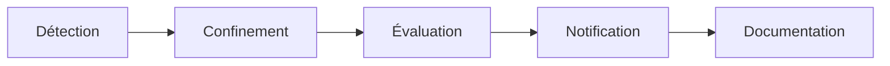

# Documentation sécurité et RGPD — Safe Campus

| Élément | Valeur |
|---|---|
| Projet | Safe Campus — SAE501, Université de la Nouvelle-Calédonie |
| Date | 20/10/2026 |
| Périmètre | Site étudiant (Nuxt 4), API et back-office (Laravel 13 / Filament 3), base PostgreSQL 17, images Docker de production |
| État du code | Branche `dev` au 20/10/2026 |
| Hébergement | Aucun hébergeur retenu. Le livrable est un jeu d'images Docker de production. |

Le document comprend deux parties : la sécurité (sections 1 à 10), puis la protection des données personnelles (sections 11 à 18).

> Aucune solution d'hébergement n'est choisie. Les mesures qui dépendent de l'hébergement (TLS, reverse proxy, volumes, sauvegarde, supervision) sont des préconisations : voir § 8.1. Elles seront arrêtées avec l'hébergeur retenu.

---

## 1. Objet et périmètre

Ce document décrit les mesures de sécurité de Safe Campus et la manière dont l'application traite les données personnelles. Il sert de référence à l'équipe projet, à l'établissement qui exploitera la plateforme et à son délégué à la protection des données (DPO).

Il couvre les deux applications du projet :

- **Safe-Campus-front** : site consulté par les étudiants.
- **Safe-Campus-back** : API REST, back-office d'administration (`/admin`) et base de données.

### 1.1 Principes directeurs

- **Protection dès la conception** : l'étudiant n'a ni compte, ni formulaire, ni suivi d'audience. Il n'y a donc aucune donnée sur lui à protéger.
- **Moindre privilège** : chaque membre du personnel n'accède qu'aux sections nécessaires à son rôle.
- **Défense en profondeur** : contrôles au niveau de l'interface, de l'application (Policies) et de la base (contraintes).
- **Traçabilité** : toute action du back-office est journalisée, sans jamais enregistrer de secret.

### 1.2 Cadre réglementaire

Le projet prend comme référentiel le RGPD (règlement UE 2016/679) et la loi Informatique et Libertés. La plateforme est exploitée en Nouvelle-Calédonie, où les règles applicables aux données personnelles présentent des spécificités.

> Le régime juridique exact applicable en Nouvelle-Calédonie doit être confirmé par le DPO de l'Université de la Nouvelle-Calédonie avant la mise en production.

---

## 2. Architecture et surfaces d'exposition

| Composant | Exposition | Protection |
|---|---|---|
| Site étudiant (Nuxt, SSR) | Public, HTTPS | Public par conception. Pendant les événements du prototype : portillon visiteur (§ 4.1). |
| API REST (`/api`) | Public, HTTPS | Lecture seule de contenus publiés, publique par conception. Seule route en écriture : `POST /api/login` (portillon visiteur). |
| Back-office (`/admin`) | Public, HTTPS | Authentification individuelle, rôles, limitation des tentatives |
| Base PostgreSQL | Réseau Docker interne uniquement | Aucun port publié en production |
| Fichiers médias | Public (lien symbolique `storage`) | Ne contient que des contenus destinés à être publiés. Formats limités par une liste blanche, 10 Mo par fichier (§ 6.3). |
| Journaux (`laravel`, `audit`) | Serveur uniquement | Aucun écran de consultation, accès par le conteneur |

### 2.1 Services tiers appelés

| Service | Appelé depuis | Donnée transmise | Finalité |
|---|---|---|---|
| OpenStreetMap (tuiles) | Navigateur (site et back-office) | Adresse IP, zone de carte consultée | Affichage des cartes |
| Esri ArcGIS (tuiles satellite) | Navigateur (back-office) | Adresse IP, zone consultée | Vue satellite lors de la saisie d'une adresse |
| Nominatim (OSM) | Serveur back | Adresse d'une structure d'aide | Géocodage d'un contact |
| Have I Been Pwned | Serveur back | 5 premiers caractères du SHA-1 du mot de passe (k-anonymat) | Refus des mots de passe ayant fuité |
| Google Fonts | Navigateur (site) | Adresse IP, en-têtes HTTP | Chargement des polices Cabin et Bebas Neue |

---

## 3. Classification des données

| Donnée | Exemple | Sensibilité | Personnelle ? |
|---|---|---|---|
| Contenus éditoriaux | Articles, histoires, médias | Publique | Non |
| Annuaire — structures | Nom de l'association, standard, horaires | Publique | Non |
| Annuaire — référent nommé | Nom, prénom, email d'un intervenant | Publique, mais personnelle | Oui |
| Comptes du back-office | Nom, prénom, email, téléphone, rôle | Interne | Oui |
| Mots de passe | Hash bcrypt | Secret | Oui |
| Jetons d'accès | Jeton Sanctum du portillon visiteur | Interne | Non (compte partagé) |
| Journal d'audit | Auteur, action, IP, date | Interne | Oui |
| Secrets de configuration | `APP_KEY`, mots de passe BD et visiteur | Secret | Non |

> Aucune donnée de santé n'est traitée. L'application ne sait pas quel étudiant consulte quelle fiche : pas de compte individuel, pas de mesure d'audience, pas de formulaire.

---

## 4. Authentification

### 4.1 Portillon visiteur du prototype

Le site étudiant et l'API de lecture sont publics par conception. En production, ils sont consultables sans compte ni mot de passe. Seul le back-office (`/admin`) et ses ressources sont protégés.

Le prototype n'est pas déployé en production (seule la démo Render existe, § 8.2). Lors des événements où la plateforme est présentée, un **portillon visiteur** limite l'accès au site étudiant. Ce portillon n'est pas une authentification : il ne protège aucune donnée, l'API de lecture restant publique.

- Un middleware global redirige vers `/login` toutes les pages, sauf `/login`, `/mentions-legales`, `/cgu` et `/donnees-personnelles`, tant que le cookie `sc_token` est absent. Il vérifie la présence du cookie, pas sa validité.
- Le mot de passe est partagé. Le compte visiteur n'est pas nominatif. Ses identifiants sont définis dans la configuration serveur (`VISITEUR_EMAIL` / `VISITEUR_PASSWORD`), jamais dans le code. Le mot de passe est changé par variable d'environnement entre deux événements.
- `POST /api/login` renvoie un jeton Sanctum. Le front le stocke dans le cookie `sc_token` (`SameSite=Lax`).
- Le jeton n'a pas de durée de vie : le portillon n'a pas vocation à expirer pendant un événement.
- Le compte visiteur ne peut pas accéder au back-office : `canAccessPanel()` n'accepte que `webmaster`, `redacteur`, `relecteur` et `admin`.
- En production, le compte visiteur, la page de connexion et le middleware sont retirés (S-10).

Les limites connues du portillon sont listées au § 10.2.

### 4.2 Comptes du back-office

- Comptes individuels et nominatifs. La session Laravel (guard `web`) utilise un cookie `HttpOnly` et `SameSite=Lax`.
- **Inscription contrôlée** : un compte créé depuis `/admin/register` n'a aucun rôle. Il ne peut pas se connecter tant qu'un administrateur ne lui en a pas attribué un.
- **Anti-énumération** : le message « compte en attente de validation » ne s'affiche qu'après un mot de passe correct. Il ne révèle donc pas si une adresse email est inscrite.
- **Limitation des tentatives** : 5 connexions par minute et 2 inscriptions par minute.
- Email enregistré en minuscules, unique sans tenir compte de la casse.
- Premier administrateur créé à la migration (`ADMIN_EMAIL` / `ADMIN_PASSWORD`). En production, la migration échoue si son mot de passe ne respecte pas la politique ci-dessous.

### 4.3 Politique de mots de passe

| Règle | Valeur |
|---|---|
| Longueur | 14 à 72 caractères |
| Complexité | Au moins une majuscule, une minuscule et un caractère spécial |
| Fuites connues | Refusé s'il apparaît dans la base Have I Been Pwned. k-anonymat : le mot de passe ne quitte jamais le serveur. |
| Stockage | Hash bcrypt, jamais en clair, jamais journalisé |

---

## 5. Autorisations et rôles

Chaque compte a un rôle unique. La liste des rôles est fixée par une énumération et une contrainte CHECK en base : aucun écran ne permet d'en créer. Les droits sont appliqués par une Policy Laravel par ressource. Une ressource non autorisée disparaît du menu et répond 403 si on y accède directement.

| Ressource | `webmaster` | `redacteur` | `relecteur` | `admin` | `visiteur` |
|---|---|---|---|---|---|
| Thèmes / Sous-thèmes | ✓ | — | — | — | — |
| Contacts / Téléphones | ✓ | — | — | — | — |
| Médias | ✓ | ✓ | — | — | — |
| Histoires / Scènes / Choix | — | ✓ (les siennes, en brouillon) | ✓ (toutes ; pas de création d'histoire) | — | — |
| Utilisateurs | — | — | — | ✓ | — |
| Accès au back-office | ✓ | ✓ | ✓ | ✓ | ✗ |

### 5.1 Garde-fous

- Un administrateur ne peut ni modifier ni supprimer son propre compte. Le dernier administrateur ne peut donc pas disparaître.
- Le compte visiteur n'apparaît pas dans la liste des utilisateurs. On ne peut ni l'attribuer à quelqu'un ni le supprimer.
- Avant de supprimer un rédacteur, il faut transférer ses histoires à un autre rédacteur ou à un relecteur. Sans repreneur, rien n'est supprimé.
- Un rédacteur ne voit que ses histoires, et ne modifie ni ne supprime que celles en brouillon.
- Un rédacteur ne peut pas poser `valide` ni `publie` : la valeur est refusée côté serveur.
- Retirer son rôle à un compte le désactive immédiatement, sans le supprimer.

---

## 6. Protection des données

### 6.1 En transit

- HTTPS de bout en bout : le certificat TLS et le reverse proxy sont à fournir par l'hébergement retenu. Les conteneurs ne parlent que HTTP.
- Requêtes inter-domaines : `config/cors.php` limite l'API (`api/*`) aux origines de `CORS_ALLOWED_ORIGINS`, sans cookies cross-origin (S-09).

### 6.2 Au repos

- Base PostgreSQL accessible uniquement depuis le conteneur back. Mot de passe aléatoire d'au moins 20 caractères.
- L'application se connecte avec le compte créé par l'image PostgreSQL (`POSTGRES_USER`), qui est superutilisateur (S-18).
- `APP_KEY` générée une seule fois, conservée dans les variables d'environnement de l'hébergement, jamais régénérée.
- Les secrets sont stockés uniquement dans les variables d'environnement. Les fichiers `.env` sont exclus de Git et des images Docker.

### 6.3 Sécurité applicative

| Risque | Mesure |
|---|---|
| Injection SQL | ORM Eloquent et requêtes paramétrées, aucune concaténation SQL |
| XSS | Contenus affichés par l'interpolation Vue (échappement automatique). Aucun `v-html` dans le front (vérifié le 20/10/2026). |
| CSRF | Jeton CSRF natif de Laravel / Livewire sur le back-office. L'API utilise un jeton Bearer, pas de cookie de session. |
| Saisie forgée | Validation serveur de chaque champ (type, format, unicité), y compris quand un tableau est envoyé à la place d'une chaîne |
| Fuite d'informations | `APP_DEBUG=false` et `LOG_LEVEL=error` en production. L'API n'expose jamais les chemins disque, l'auteur, l'état ou les dates. |
| Fichier piégé au téléversement | Liste blanche de types MIME par type de média, vérifiés sur le contenu du fichier et non sur son extension : PNG, JPEG, WebP · MP4, WebM · MP3, OGG · PDF. SVG et HTML refusés : servis depuis le domaine du back-office, ils pourraient exécuter du script. 10 Mo par fichier, limite PHP à 12 Mo. Le type d'un média n'est plus modifiable après sa création. |
| Redirection ouverte | Le paramètre de retour du lecteur d'histoire n'accepte que des chemins internes (commence par `/`, jamais par `//`). Celui de la page de connexion est passé à `navigateTo()`, qui refuse toute URL externe par défaut. |
| Contenu non publié | Seules les histoires « publiées » et les contacts / médias actifs sont servis par l'API |

---

## 7. Traçabilité et journalisation

| Caractéristique | Valeur |
|---|---|
| Canal | `audit`, distinct du journal applicatif |
| Fichiers | `storage/logs/audit-AAAA-MM-JJ.log`, un par jour |
| Format | JSON, une entrée par ligne, horodatage UTC |
| Conservation | 365 jours, purge automatique |
| Événements | Création, modification (avant / après) et suppression des données métier. Connexion, échec de connexion, déconnexion, inscription. Transfert d'histoires. Purge d'un compte inactif (`User.purge_inactivite`) ou ignorée faute de repreneur (`User.purge_ignoree`), auteur `console`. Circuit d'une histoire : `Histoire.etat_change` (`de`, `vers`). Rattachements d'une histoire : `Histoire.scene_ajoutee` (`scene_id`, et `reutilisee` si la scène existait déjà), `Histoire.scene_retiree` (`scene_id`), `Histoire.scene_deplacee` (`scene_id`, `sens` haut ou bas), `Histoire.depart_defini` (`scene_id`), `Histoire.sous_themes_modifies` (`ajoutes`, `retires`). Accès refusés : `Histoire.acces_refuse` (`motif` : `hors_perimetre` pour un 404 ; `droit_refuse` pour un 403 de page ou d'écriture de scène, avec `capacite`). Suppression groupée d'histoires : `Histoire.suppression_groupee` (`supprimees`, `refusees` : identifiants seulement). |
| Contenu d'une entrée | Action, objet concerné, auteur (identifiant et rôle), adresse IP, détails |
| Exclusions | Jamais de mot de passe ni de jeton. Jamais le titre ni le texte d'une scène ou d'un choix : seuls l'identifiant et le nom des champs modifiés sont écrits. Autres textes longs tronqués à 200 caractères. Jamais d'adresse e-mail, de nom, de prénom ni de téléphone de compte : un compte est désigné par son identifiant. Échec de connexion (`auth.echec`) : jamais l'adresse saisie ; `compte_id` seulement si le compte existe, et `compte_connu`. |
| Fiabilité | Écrit après validation de la transaction : une action annulée n'est pas tracée |
| Accès | Serveur uniquement |

> Les entrées écrites avant cette règle peuvent contenir les 200 premiers caractères d'un dialogue, et des adresses e-mail (comptes et adresses saisies à la connexion), jusqu'à leur purge à 365 jours. Une adresse saisie par erreur peut même contenir un mot de passe.

> Limite connue : les e-mails et téléphones des contacts de l'annuaire peuvent encore apparaître dans les valeurs journalisées. À traiter séparément.

> Les rattachements des histoires (scènes, sous-thèmes) sont tracés par des événements explicites (`Histoire.scene_ajoutee`, `Histoire.sous_themes_modifies`, etc.). Les autres rattachements (média ↔ sous-thème, contact ↔ sous-thème) ne déclenchent pas d'événement de modèle : ils ne sont pas tracés (S-16).

> Les journaux sont montés sur le volume `scback-logs-prod` : un redéploiement ne les efface pas. Sur la démo Render (disque éphémère), ils disparaissent au redémarrage (S-06, § 8.2).

---

## 8. Infrastructure et déploiement

Aucun hébergeur de production n'est retenu. Le livrable s'arrête aux images Docker de production, déployables sur tout hôte Docker. Le reverse proxy, le certificat TLS, le stockage persistant et la sauvegarde sont à fournir par l'hébergement.

Une démo publique temporaire tourne sur Render et Neon (§ 8.2). Elle ne tient pas lieu d'hébergement de production.

- Les images de production sont séparées des images de développement. Elles ne contiennent ni Xdebug, ni Adminer, ni dépendances de développement. L'image front ne contient que le build `.output/`, sans code source.
- Les fichiers `.env` sont exclus des images (`.dockerignore`).
- Les conteneurs back et site étudiant tournent avec un utilisateur non administrateur. L'image de production du site étudiant utilise `node`, fourni par l'image Node, et ne peut pas modifier son build `.output/` (S-12, corrigé).
- L'image back sert l'application avec `php artisan serve`, serveur de développement mono-processus (S-11).
- Le réseau Docker de production (`scback_prod`) est séparé de celui de développement (`scback`).
- Les commandes post-déploiement excluent tout jeu de données de démonstration : `db:seed` est interdit en production. Seule exception, la démo publique : `DEMO_CONTENT=true` autorise les seeders de démo (`config/demo.php`, faux par défaut, § 8.2).
- Une sauvegarde de la base est obligatoire avant toute migration en production.
- Les médias (`storage/app`) et les journaux (`storage/logs`) sont montés sur les volumes nommés `scback-storage-prod` et `scback-logs-prod`. Reste la sauvegarde hors serveur (S-06).

### 8.1 Préconisations pour l'hébergement

Ces préconisations servent de cahier des charges pour le choix de l'hébergeur. Elles ne sont pas mises en œuvre.

| Domaine | Préconisation |
|---|---|
| Exposition | Seuls les ports 80 et 443 ouverts. Le port 80 redirige vers HTTPS. Base et conteneurs jamais exposés directement. |
| TLS | Reverse proxy devant les deux conteneurs, certificat renouvelé automatiquement. |
| En-têtes et débit | En-têtes de sécurité (S-05) et limitation de débit posés au niveau du reverse proxy, en complément de l'application. |
| Stockage | Volumes persistants pour la base, les médias et les journaux (S-06). |
| Sauvegarde | Sauvegarde quotidienne de la base et des médias, stockée hors du serveur. Restauration testée chaque trimestre. |
| Secrets | Variables d'environnement gérées par l'hébergement, jamais dans un fichier versionné. Accès réservé aux administrateurs techniques. |
| Supervision | Disponibilité, erreurs applicatives, espace disque. Alertes sur les échecs de connexion répétés du journal d'audit (S-07). |
| Préproduction | Environnement identique à la production pour valider migrations et montées de version avant la mise en ligne. |
| Localisation | Serveurs situés dans une zone compatible avec le régime de protection des données retenu par le DPO (§ 1.2). |
| Contrat | Contrat de sous-traitance conforme à l'article 28 du RGPD (§ 16). |

### 8.2 Démo publique (Render et Neon)

Mise en ligne temporaire pour présenter le prototype. Procédure et variables : [deploiement-render.md](deploiement-render.md).

| Élément | Choix | Conséquence pour la sécurité |
|---|---|---|
| Hébergement applicatif | Render, 2 services web gratuits, région Oregon (États-Unis) | HTTPS et reverse proxy fournis par Render. Hébergeur hors Union européenne : voir § 16. |
| Base de données | Neon, PostgreSQL 17, région `us-west-2` | Connexion directe, `sslmode=require`. Les droits exacts du rôle `neondb_owner` n'ont pas été vérifiés : S-18 n'est pas évalué sur cette démo. |
| Secrets | Variables d'environnement de chaque service Render, saisies par un administrateur | Aucune valeur dans git (`.env.*` ignorés par git et Docker) ni dans les images. Un gestionnaire de secrets externe (Doppler) a été évalué puis écarté : dépendance et clé d'API Render supplémentaires, sans gain pour une démo d'une semaine. |
| Contenu | `DEMO_CONTENT=true` : médias de démonstration, compte rédacteur de démo et 9 histoires (`docker/8.4/start-prod`) | Les contacts sont des structures d'aide publiques. Aucune donnée d'étudiant n'est collectée. |
| Disque | Éphémère (plan gratuit) | Médias recréés à chaque démarrage par `docker/8.4/start-prod`. Les fichiers téléversés depuis `/admin` disparaissent au redémarrage. |
| Histoires de démo | Rejouées à chaque démarrage | Toute modification d'une des 9 histoires dans `/admin` est écrasée au redémarrage suivant. |

Limites assumées de la démo :

- Pas de sauvegarde de la base en dehors de celle de Neon, pas de supervision (S-07), pas de planificateur (S-19 : la purge des comptes inactifs ne tourne pas).
- `artisan serve` avec deux processus (`PHP_CLI_SERVER_WORKERS=2`) sur 512 Mo : mono-hôte, sans haute disponibilité (S-11).
- Mise en veille après 15 minutes d'inactivité : premier appel suivant d'environ une minute.
- Le portillon visiteur reste actif (prototype, § 4.1).
- Aucun contrat de sous-traitance (art. 28) n'est signé avec Render ni Neon. La démo ne doit contenir que des données de démonstration. Les comptes du personnel créés dans `/admin` sont des comptes de test.

---

## 9. Maintenance de la sécurité

| Action | Fréquence |
|---|---|
| Revue et mise à jour des dépendances npm / Composer (Dependabot ou Renovate) | Mensuelle |
| Veille CVE sur Nuxt, Laravel, Filament, PHP, Node, PostgreSQL | Continue |
| Revue des comptes du back-office et des rôles attribués | Trimestrielle |
| Changement du mot de passe du portillon visiteur | Entre deux événements du prototype, et dès qu'une fuite est suspectée |
| Rotation des secrets (BD, compte admin initial) | Annuelle, ou après le départ d'un administrateur |
| Test de restauration d'une sauvegarde | Trimestrielle |
| Montées de version majeures | Selon le calendrier de fin de support des composants |

État des dépendances au 27/10/2026 (audits rejoués par la CI, job `approfondi`, voir [ci.md](ci.md)) :

| Dépôt | Outil | Vulnérabilités connues |
|---|---|---|
| Back | `composer audit --locked` | Aucune. Bloquant en CI. |
| Front | `npm audit` | 7 de gravité haute et 1 basse, dans la chaîne d'outillage de Nuxt (serveur de développement, build) ; aucune critique. Les critiques bloquent la CI ; les hautes sont affichées sans bloquer. Correctif proposé par npm : retour à Nuxt 3, non retenu. |
| Images de prod | Trivy, CRITICAL corrigeables | Aucune. Bloquant en CI. |

Dependabot n'est pas configuré : la revue mensuelle ci-dessus reste manuelle.

---

## 10. Mesures complémentaires à mettre en œuvre

État constaté dans le code le 27/10/2026. Réalisées : S-02 (atténué), S-09, S-13 ; partielles : S-05 (back seulement), S-06, S-14, S-16. Les autres restent à faire.

### 10.1 Écarts à corriger avant la mise en production

| ID | Mesure | Constat | Priorité |
|---|---|---|---|
| S-05 | Ajouter les en-têtes HTTP de sécurité (HSTS, CSP, X-Content-Type-Options, Referrer-Policy) | Back : posés par le middleware `SecurityHeaders` (HSTS en HTTPS, nosniff, Referrer-Policy, X-Frame-Options, `frame-ancestors`, CSP `default-src 'none'` sur l'API). À faire : en-têtes du front, CSP de scripts du site et de l'admin (Alpine exige `unsafe-eval`), fichiers de `public/storage` servis hors Laravel | Moyenne |
| S-06 | Créer les volumes persistants (médias, journaux) et la sauvegarde quotidienne hors serveur | Volumes `storage/app` et `storage/logs` créés dans `docker-compose.prod.yml`. Sauvegarde hors serveur non faite. Sur Render gratuit, le disque est éphémère (§ 8.2). | Haute |
| S-07 | Mettre en place la supervision (disponibilité, erreurs) et des alertes | Rien en place | Moyenne |
| S-08 | Héberger les polices sur le serveur au lieu de Google Fonts | Polices chargées depuis Google | Moyenne |
| S-09 | Limiter les requêtes inter-domaines au domaine du site étudiant | Fait : `config/cors.php`, origines lues dans `CORS_ALLOWED_ORIGINS` | Moyenne |
| S-10 | Adapter les images de production au lancement officiel : retirer le compte visiteur, la page de connexion et le middleware du front. Retirer aussi du front la ligne « portillon » et la section « cookie » de la page Données personnelles, et `/donnees-personnelles` de `PUBLIC_PATHS` | Les images exigent le compte visiteur : sans ses variables, le premier déploiement échoue | Haute (au lancement officiel) |
| S-11 | Remplacer le serveur de développement par un serveur d'application de production | L'image lance `artisan serve`, mono-processus | Haute |
| S-13 | Rendre sécurisé le cookie de session du back-office en production | Fait : `SESSION_SECURE_COOKIE=true` par défaut dans `docker-compose.prod.yml`. Avec `TRUSTED_PROXIES` renseigné, le cookie porte `secure; httponly` (vérifié sur l'image) | Moyenne |
| S-14 | Figer les versions des images utilisées au build | Image Composer encore en « latest ». Dans la CI, l'action Trivy est épinglée par commit ; les autres actions GitHub le sont par étiquette (`@v4`). | Basse |
| S-16 | Tracer les rattachements entre éléments dans le journal d'audit | Partiellement traité : rattachements des scènes et des sous-thèmes d'une histoire tracés. Médias ↔ sous-thèmes et contacts ↔ sous-thèmes non tracés. | Basse |
| S-18 | Connecter l'application avec un utilisateur dédié, propriétaire de la base mais sans droits superutilisateur, créé par un script d'initialisation de PostgreSQL | L'application utilise le compte superutilisateur créé par l'image | Moyenne |
| S-19 | Lancer le planificateur Laravel en production (cron de l'hôte : `schedule:run` chaque minute, voir `deploiement.md`) | Aucun planificateur dans l'image : la purge des comptes inactifs à 3 ans ne s'exécute pas | Haute |

### 10.2 Limites connues du portillon visiteur

Ces limites sont assumées pour le prototype. Elles disparaissent en production avec le portillon (S-10).

| ID | Limite | Conséquence |
|---|---|---|
| S-01 | L'API de lecture ne vérifie aucun jeton | Le portillon filtre l'affichage du site, pas l'accès aux contenus |
| S-02 | Limite de 30 tentatives par minute et par IP sur `POST /api/login` (`throttle:30,1`) | Atténué : une limite plus basse bloquerait des visiteurs légitimes derrière le NAT du campus. La longueur du mot de passe partagé reste la vraie protection. Sans `TRUSTED_PROXIES`, derrière un proxy, tous les visiteurs partagent l'IP du proxy. |
| S-03 | Jetons sans durée de vie ni purge | Un jeton de plus en base à chaque connexion |
| S-04 | Cookie `sc_token` sans attribut `Secure` | Le cookie peut circuler hors HTTPS |
| S-15 | La déconnexion efface le cookie sans révoquer le jeton | Un jeton copié reste valide |
| S-17 | Cookie posé par le navigateur, sans `HttpOnly` | Cookie lisible par JavaScript. Atténué : aucun `v-html` dans le front. |
| — | Le middleware vérifie la présence du cookie, pas sa valeur | Un cookie `sc_token` quelconque ouvre le site |

---

## 11. Acteurs et responsabilités

| Rôle RGPD | Acteur |
|---|---|
| Responsable de traitement | Université de la Nouvelle-Calédonie (établissement exploitant) — à confirmer |
| Délégué à la protection des données | DPO de l'établissement — coordonnées à compléter |
| Sous-traitant hébergement | Hébergeur — à désigner |
| Conception | Équipe projet SAE501 |

---

## 12. Registre des traitements

| Traitement | Personnes concernées | Données | Finalité | Base légale | Conservation |
|---|---|---|---|---|---|
| Gestion des comptes du back-office | Personnel du campus | Nom, prénom, email, téléphone, rôle, mot de passe (hash) | Administrer les contenus | Mission d'intérêt public / intérêt légitime | Durée de la fonction. Suppression par l'admin, ou automatique après 3 ans sans connexion. |
| Demandes d'inscription | Personnel demandeur | Idem | Valider l'accès | Mesures précontractuelles / intérêt légitime | Jusqu'à validation ou refus |
| Annuaire des structures d'aide | Référents nommés des structures | Nom, prénom, email professionnel, adresse de permanence | Orienter les étudiants vers l'aide | Mission d'intérêt public | Tant que le référent est en poste. Effacement sur demande. |
| Journal d'audit | Utilisateurs du back-office | Identifiant du compte, rôle, action, IP, date | Sécurité, traçabilité | Intérêt légitime / obligation de sécurité | 365 jours |
| Session du back-office | Utilisateurs du back-office | Cookie de session, identifiant, IP, navigateur (table `sessions`) | Maintenir la connexion | Intérêt légitime | 120 minutes d'inactivité (`SESSION_LIFETIME`) |
| Services tiers du site (polices, cartes) | Visiteurs du site | IP et en-têtes HTTP transmis à Google Fonts et OpenStreetMap (§ 2.1) | Afficher polices et cartes | À confirmer par le DPO | Aucune conservation par Safe Campus |
| Portillon visiteur (prototype) | Visiteurs des événements | Aucune donnée identifiante (compte partagé). Cookie technique. | Restreindre l'accès au prototype pendant les événements | Intérêt légitime | Durée du cookie de session navigateur |

Les bases légales sont à valider par le DPO.

---

## 13. Principes appliqués

| Principe | Application dans Safe Campus |
|---|---|
| Minimisation | Aucun compte, formulaire ou outil de mesure d'audience pour les étudiants. Pour le personnel, seules les données utiles au contact et à l'administration sont collectées. |
| Limitation des finalités | Les données du personnel ne servent qu'à la gestion des accès. `User` et `Contact` sont deux tables sans aucun lien. |
| Exactitude | Contacts tenus à jour par le webmaster. Champ `actif` pour retirer immédiatement une structure du site. |
| Limitation de la conservation | Purge automatique de l'audit à 365 jours. Purge automatique des comptes sans connexion depuis 3 ans (`comptes:purger-inactifs`, quotidienne). Suppression des comptes et des contacts nommés possible à tout moment. |
| Intégrité et confidentialité | Mesures de la partie A (§ 4 à 10) |
| Protection dès la conception | Pas de collecte côté étudiant. La consultation de thématiques sensibles (santé mentale, violences) ne laisse aucune trace nominative. |

---

## 14. Droits des personnes

| Droit | Mise en œuvre |
|---|---|
| Accès / rectification | Sur demande, l'administrateur communique ou rectifie les données d'un compte. Le webmaster fait de même pour un contact. |
| Effacement | Suppression définitive d'un compte par l'admin, ou d'un contact par le webmaster. Suppression en cascade des téléphones et des rattachements. |
| Opposition / limitation | Retrait du rôle (compte conservé mais inactif) ou désactivation d'un contact |
| Portabilité | Extraction des données du compte sur demande, par requête en base |
| Réclamation | Auprès du DPO de l'établissement, puis de l'autorité de contrôle compétente |

**Procédure** : la demande est adressée au contact indiqué dans les mentions légales. Elle est transmise au DPO et traitée dans un délai d'un mois. L'opération réalisée dans le back-office apparaît dans le journal d'audit.

**Purge des comptes inactifs** : la date de dernière connexion (`users.derniere_connexion_at`) est mise à jour à chaque connexion au back-office. Un compte sans connexion depuis 3 ans (inscription pour un compte jamais connecté) est supprimé chaque jour. Exclus : le visiteur, les admins, et les comptes auteurs d'histoires (signalés dans le journal d'audit, `User.purge_ignoree`, un admin choisit le repreneur et supprime à la main). Aucun email d'avertissement n'est envoyé avant suppression.

> L'effacement d'un compte supprime la ligne en base. Les entrées déjà écrites dans le journal d'audit sont conservées jusqu'à leur purge automatique à 365 jours, au titre de l'obligation de sécurité.

---

## 15. Cookies et traceurs

| Cookie | Application | Rôle | Consentement |
|---|---|---|---|
| `sc_token` | Site étudiant (prototype uniquement) | Contient le jeton du portillon visiteur | Non requis (strictement nécessaire) |
| Session Laravel | Back-office | Maintient la connexion du personnel | Non requis (strictement nécessaire) |
| `XSRF-TOKEN` | Back-office | Protection contre le CSRF | Non requis (strictement nécessaire) |

Aucun cookie publicitaire ou de mesure d'audience n'est déposé : aucun bandeau de consentement n'est nécessaire.

### 15.1 Ressources tierces

Le chargement des polices Google Fonts et des tuiles cartographiques transmet l'adresse IP du visiteur à ces services. Google est situé hors de l'Union européenne : il est recommandé d'héberger les polices sur le serveur Safe Campus (S-08). Les tuiles OpenStreetMap ne sont chargées que sur les pages contact.

---

## 16. Sous-traitants et transferts

| Destinataire | Données | Localisation | Encadrement |
|---|---|---|---|
| Hébergeur | Toutes les données de la plateforme | À désigner | Contrat de sous-traitance (art. 28 RGPD) |
| Render (démo publique) | Applications, journaux, variables d'environnement | États-Unis (Oregon) | Aucun contrat spécifique. Démo à données de démonstration uniquement (§ 8.2). |
| Neon (démo publique) | Base de données de la démo | États-Unis (`us-west-2`) | Idem |
| GitHub (dépôts publics, CI) | Code source, historique, résultats de la CI | États-Unis | Dépôts publics : aucun secret détecté dans l'historique (scan du 27/10/2026). Les noms et adresses e-mail des auteurs de commits y sont visibles. |
| OpenStreetMap Foundation | IP du navigateur, adresses de structures | Royaume-Uni (décision d'adéquation) | Politique d'usage OSM |
| Esri | IP du navigateur (back-office) | États-Unis | Usage limité au personnel |
| Google Fonts | IP du navigateur | États-Unis | À supprimer (S-08) |
| Have I Been Pwned | Fragment de hash non réversible | International | Pas de donnée personnelle |

---

## 17. Gestion des violations de données

- **Détection** : alertes de supervision, anomalies dans le journal d'audit (échecs de connexion répétés, suppressions inhabituelles).
- **Confinement** : retrait du rôle des comptes compromis, révocation des jetons Sanctum, changement des secrets concernés (mot de passe visiteur, BD, `APP_KEY` si nécessaire).
- **Évaluation** : nature des données, nombre de personnes, gravité.
- **Notification** : au DPO sans délai. À l'autorité de contrôle dans les 72 heures si la violation présente un risque. Aux personnes concernées si ce risque est élevé.
- **Documentation** : inscription au registre des violations, retour d'expérience et mesures correctives.

---

## 18. Actions avant mise en production

| Action | Responsable |
|---|---|
| Désigner le responsable de traitement et compléter les mentions légales (éditeur, hébergeur, contact, DPO) | Établissement |
| ~~Ajouter aux CGU une section « Données personnelles »~~ Fait : page `/donnees-personnelles` du site (visiteurs, liée depuis le pied de page et les menus) et section « Données personnelles » des CGU du back-office (`/cgu#donnees-personnelles`, aussi résumée sur les pages de connexion et d'inscription). Contenu à faire valider par le DPO avant la mise en production. | Équipe projet |
| Inscrire les traitements au registre de l'établissement | DPO |
| Choisir l'hébergeur à partir des préconisations du § 8.1 et signer le contrat de sous-traitance | Établissement |
| Informer les référents nommés de l'annuaire de leur présence et de leurs droits | Webmaster |
| Corriger les écarts du § 10.1, en commençant par les priorités hautes | Équipe projet |

## Points à arrêter avec l'établissement

1. Quel régime de protection des données s'applique en Nouvelle-Calédonie ? (à confirmer par le DPO de l'UNC)
2. Qui est le responsable de traitement : l'UNC ou une autre entité ?
3. L'hébergement est-il assuré par l'établissement ou par un prestataire externe ?
4. Quel hébergeur est retenu, et où sont situés ses serveurs ?
5. L'accès au back-office (`/admin`) doit-il être restreint au réseau de l'établissement ?
